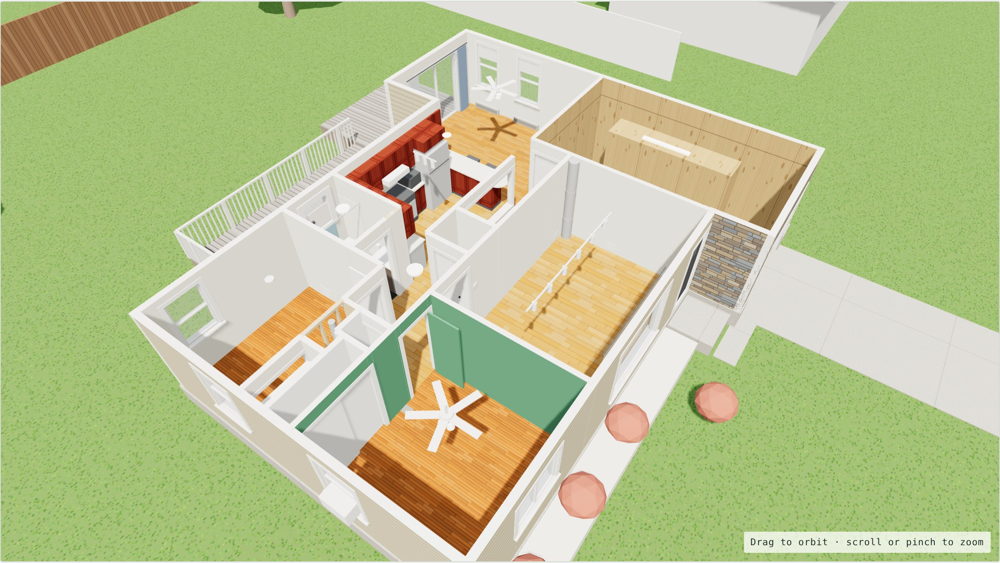
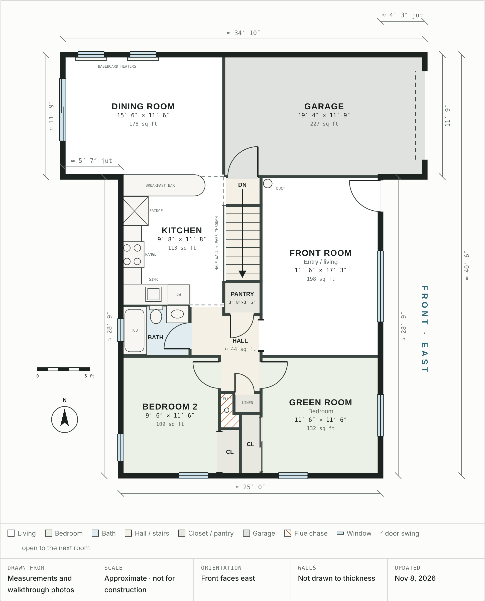

# Alpine House

Planning files for the house renovation.

## Contents

- **[existing-conditions.md](existing-conditions.md)**: a room-by-room record of the house as it is now. It covers sizes, windows, doors, closets, cabinets, floors, lighting, heating vents, electrical and plumbing, plus the issues to fix and the open questions.
- **[photos/](photos/)**: 18 walkthrough photos of every main-floor room, the garage, and the front and back of the house, each with a description.
- **[floor-plan/](floor-plan/)**: the measured main-floor plan. It has an interactive page (`index.html`), a picture of the plan and a room size schedule.
- **[renderings/](renderings/)**: dated 3D models of the house. The [baseline](renderings/2026-11-08-baseline/) shows the house as it is today and is the starting point for comparing every change.
- **[concepts/](concepts/)**: renovation ideas drawn on the floor plan. The first set, [layout concepts](concepts/2026-11-08-layout-concepts/), covers flow, use of space and feel. Both dream plans are modeled in 3D next to the baseline: [the garage as a living room](renderings/2026-11-08-dream-plan/) and [the garage kept](renderings/2026-11-08-dream-plan-garage-kept/).

