# Layout concepts (November 8, 2026)

Sixteen ideas for the main floor that focus on **flow, use of space and how the house feels**. Colors, finishes and fixtures come later.

Each concept is drawn on the measured [floor plan](../../floor-plan/), with the same orientation: north is up and the front of the house (east) is on the right. The starting point is the [baseline model](../../renderings/2026-11-08-baseline/).

**Open `index.html` in a browser** for the interactive version: tabs for each concept, numbered callouts and a side-by-side table.

## Key to the drawings

- **Orange dashed line:** a wall that's removed (or, on the "Today" and concept 1 drawings, today's route from the front door to the deck).
- **Teal solid line:** a new wall.
- **Line with ticks:** a half wall with a railing.
- **Teal fill:** a space or fixture that changes.
- **Teal dashed line:** the new route from the front door to the deck slider.
- **Grey dashed boxes and circles:** furniture and stools, to show how the rooms would be used.
- **Teal dashed box with a thick edge (concept 5):** the lift-up lid and its hinge. A thick teal line shows the lid standing up.

## Today

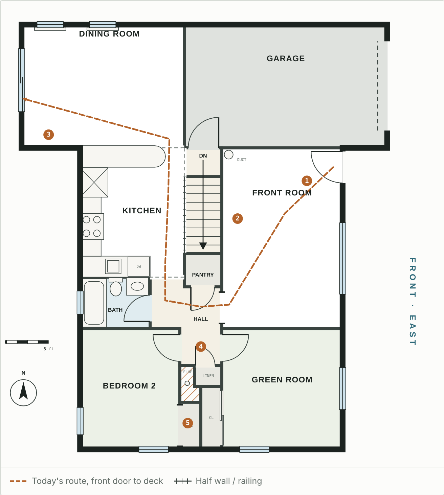

What holds the layout back:

1. The front door opens into a corner of the front room, with no closet or landing spot.
2. The stairs, pantry and landing make a solid block down the middle. The front room reaches the rest of the house only through one doorway to the hall.
3. The brightest room, with the slider to the deck, is in the far back corner, as far as you can get from the front door.
4. The hall has no windows, and five doors open off it.
5. The flue chase and a 2′ × 4′ 6″ closet use up the space between the bedrooms.

The walk from the front door to the deck is about **53 ft**, zigzagging through the front room, hall and kitchen.

## 1 · Live in the back

*Move furniture, not walls.*

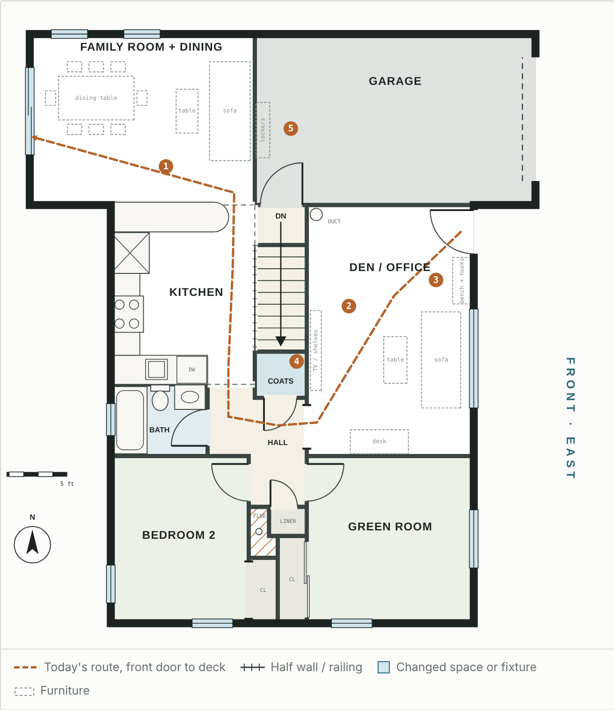

1. Turn the dining room into a **family room with dining**: a sofa and chairs against the garage wall, the table under the north windows, and a clear lane from the kitchen to the slider. Take out the two baseboard heaters so the north wall can be used.
2. The front room becomes a quieter **den, office or playroom**, with the TV on the long stair-side wall and a desk on the south wall.
3. Add a **drop zone** by the front door: a bench, hooks and a shoe cabinet on the short wall between the door and the picture window.
4. Turn the pantry into a **coat closet**, since it already has a hanging rod. Move pantry food into a tall cabinet in the kitchen.
5. Build a **garage mudroom**: lockers and a bench by the door up to the landing.

- **How it feels:** daily life happens next to the kitchen and the deck, in the room with the best light. Coats and shoes get a home by both doors.
- **Trade-off:** nothing structural changes, so the front room is still cut off from the rest of the house, and the walk from the front door to the deck stays long.
- **Rough cost:** low. Mostly furniture and simple built-ins you can do yourself. No permits.

## 2 · Open the middle

*The big flow move.*

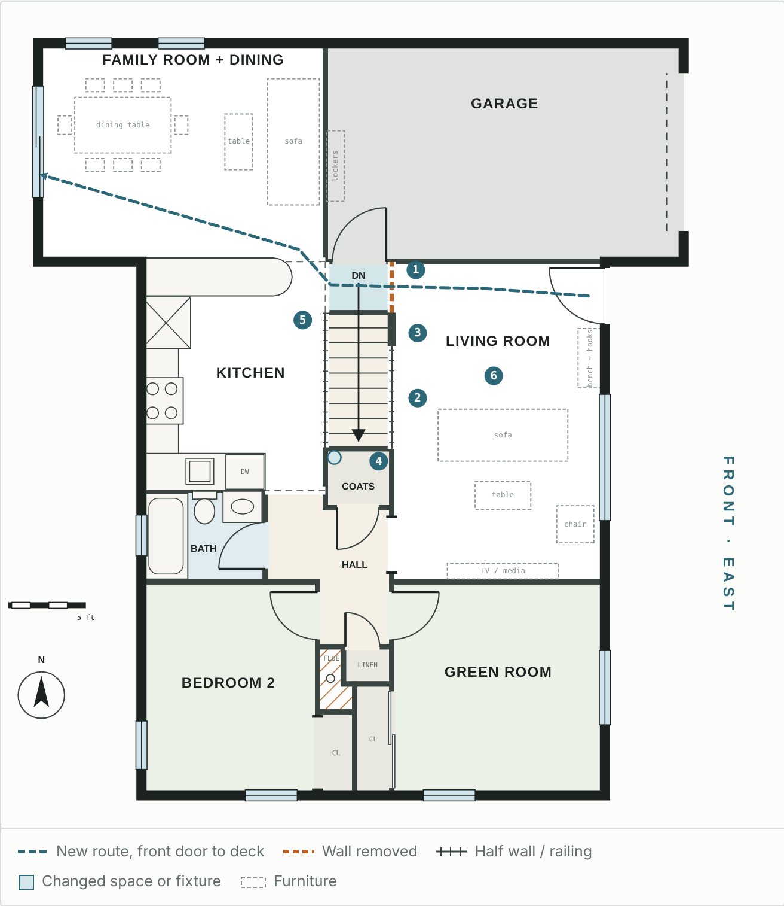

1. Remove the short wall between the front room and the stair landing.
2. Replace the front room side of the stairwell with a half wall and railing, matching the kitchen side. Light reaches the stairs and the basement.
3. Keep the electrical panel in a short wall at the top of the stairs, or move it.
4. Move the live duct out of the front room corner. It could go in a wall or up through the coat closet floor, as drawn.
5. Swap the stair gate for a proper railing and gate so the landing reads as an open hub.
6. Turn the living room to face a media wall on the south wall, so the sofa's back defines a clear entry path from the front door to the landing.

- **How it feels:** coming in the front door, you see through the house to the deck. It reads as one connected space instead of a row of separate rooms, with a loop through the middle. The walk to the deck drops to about **31 ft**.
- **Trade-off:** this is probably the load-bearing line down the middle of the house, so it needs an engineer, a beam and a permit. The TV moves to the south wall.
- **Rough cost:**
  - Removing a load-bearing wall: about $4,000–10,000.
  - Wood stair railing: $20–60 per linear foot.
  - Moving the duct a few feet: roughly $500–2,000. This is my estimate from per-foot rates; a full reroute runs $1,500–9,000.
  - Moving the electrical panel, if it isn't kept in a short wall: about $2,400–4,800.
- **Includes** concept 1's family room, coat closet and mudroom.

## 3 · Bigger bath, longer kitchen

*Builds on concept 2.*

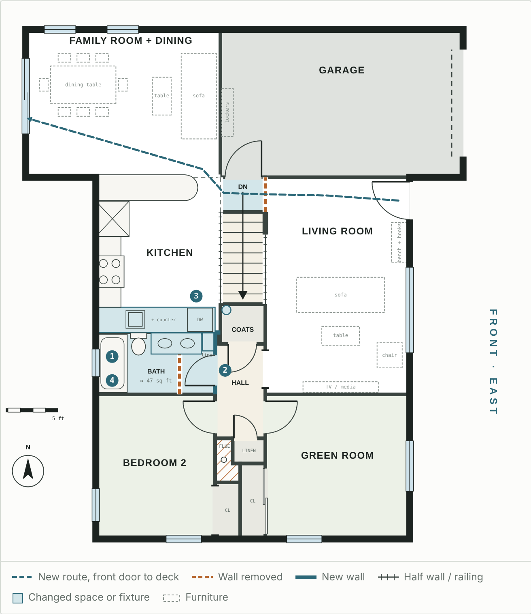

1. The bathroom grows east into the short hall, from 6′ 8″ × 4′ 11″ (33 sq ft) to about 9′ 6″ × 4′ 11″ (47 sq ft). That leaves room for a 4-ft vanity and a linen tower.
2. The bathroom door moves to open off the main hall.
3. Close the hall's opening into the kitchen. The south counter then runs the full width, adding about 3 ft of counter and cabinets.
4. Plumbing changes can be run from the unfinished basement below.

- **How it feels:** the one main-floor bathroom stops feeling cramped, and the kitchen gets real prep space without touching the breakfast bar.
- **Trade-off:** you lose the direct hall route from the bedrooms to the kitchen. You'd go through the front room and landing instead, about 15 ft further. It only makes sense together with concept 2.
- **Rough cost:** a mid-range small bathroom remodel runs about $8,000–18,000, and moving things around can push it higher. The extra kitchen cabinets and counter are on top of that.

## 4 · Reclaim the flue chase

*When the furnace and water heater are replaced.*

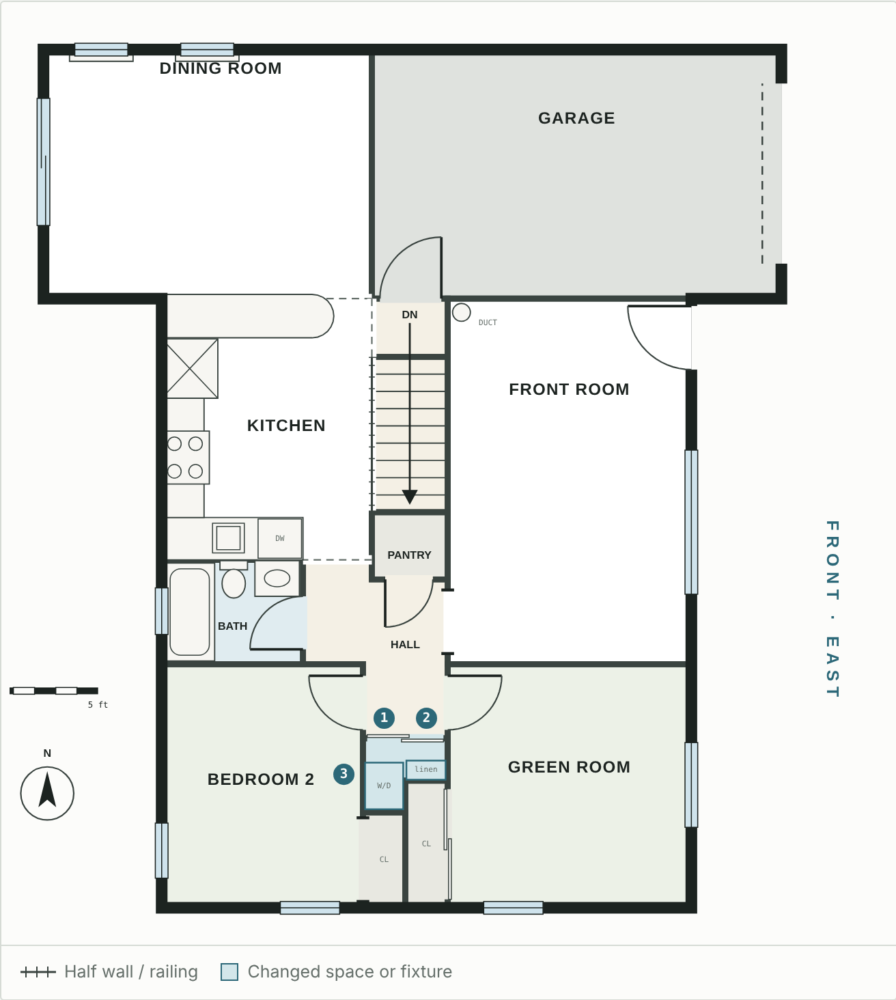

The flue pipe between the bedrooms exists only because the basement furnace and water heater vent up through the roof. Direct-vent models vent out a basement wall instead, which frees that space.

1. Remove the flue chase and combine it with the linen closet.
2. **Option A (drawn):** a laundry closet at the end of the hall, with a compact 24-inch stacked washer and dryer and linen shelves beside it. Water and drains come straight up from the unfinished basement.
3. **Option B:** extend bedroom 2's closet to about 2′ × 8′ instead, using the wall that's already open.

- **How it feels:** laundry right beside the bedrooms, or a proper closet in bedroom 2.
- **Trade-off:** it depends on replacing the furnace and water heater. A compact washer and dryer hold less than full-size ones.
- **Rough cost:** depends on the equipment. Get an HVAC quote for direct-vent units, and a plumber and electrician for the laundry hookups and dryer vent.

## 5 · Secret stair

*A stair that hides. Builds on concept 2.*

Put a counter-height island over the stairwell and make the middle of its top a lid that lifts to reveal the stairs. Closed, the middle of the house is an island between the kitchen and the living room. Open, it's a guarded stairway down.

| Lid closed: island | Lid open: stairs |
|---|---|
| 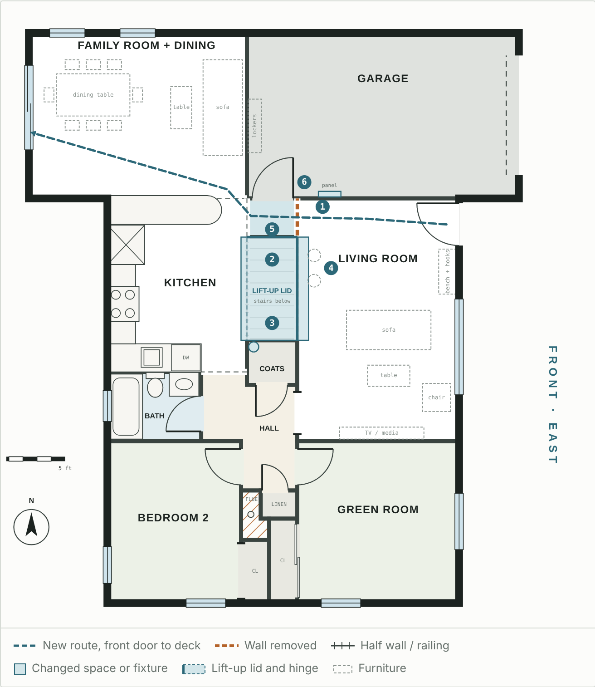 | 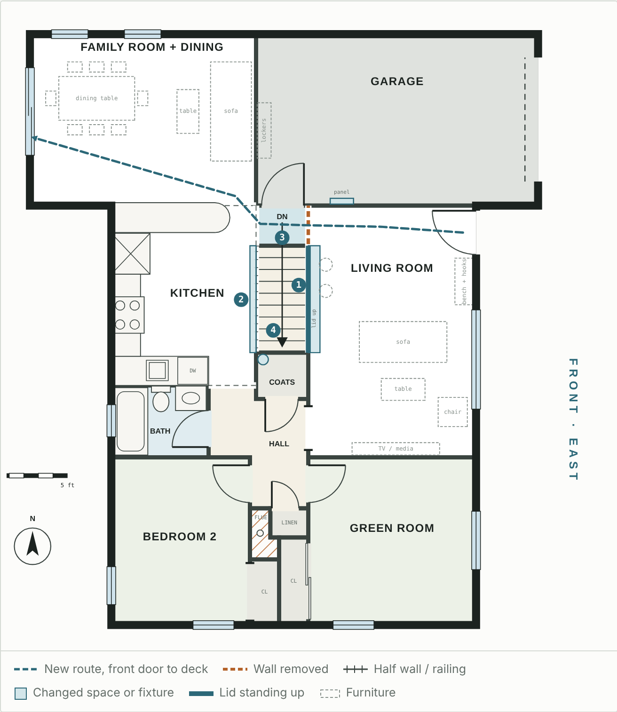 |

**With the lid closed**

1. Take down the wall between the front room and the stairwell and landing. This needs a beam to carry the load, the same structural work as concept 2. Move the duct.
2. Build a counter-height island over the stairwell, about 4′ 10″ × 7′ 4″ (35 sq ft), sitting on half walls on both sides. The half wall on the kitchen side is already there.
3. The 3′ 7″ × 7′ 4″ middle of the top is a lid. It's hinged along the living-room edge and lifted by an electric actuator with gas-spring assist.
4. Put stools at the north end on the living-room side, and open shelves under the overhang to the south.
5. A short skirt on the landing end of the lid closes off the top step, so the island looks solid when it's shut.
6. Move the electrical panel, for example to the garage side of this wall. It can't sit in a half wall, because it needs clear standing room in front of it up to 6½ ft.

**With the lid open**

1. The lid swings up and stands along the living-room side. Its top edge is about 6′ 7″ off the floor, under the 8′ ceiling, and it's the guard on that side while it's up.
2. On the kitchen side, the half wall under the counter is the guard. The landing end is the way in.
3. Put switches at the top and bottom of the stairs, battery backup for power cuts, an auto-stop so it can't close on anyone, and a manual release that works from below.
4. Anything on the lid has to come off first, so treat it as a surface you clear after use.

- **How it feels:** with the lid down there's no stairwell in the middle of the house, just an island you can see across. The living room, landing and kitchen read as one space.
- **Trade-offs:**
  - Everything on the lid has to come off before anyone can go down. That's fine for trips to storage, laundry or the furnace, but tiresome if the basement becomes bedrooms or a family room you use all day.
  - It's a custom build with moving parts that need upkeep.
  - It still needs concept 2's beam, plus moving the electrical panel.
- **Code questions:** these stairs are the basement's main way out, so covering them is the inspector's call. Expect to need:
  - a lid that opens from below without power or tools;
  - an auto-stop so it can't close on someone;
  - guards on every open side while it's up (36″ high, or 34″ along the stair);
  - a code-size egress window in the basement.

  The stair also needs 6′ 8″ of headroom, which a lid hinged on its long side allows. Talk to the building department before designing it.
- **Build notes:** keep the lid light. A stone top this size would weigh about 500 lb, so use butcher block, or a laminate-faced panel on a steel or aluminum frame. A [DIY stair hatch](https://www.progressiveautomations.com/en-se/blogs/stories/stairwell-conversion-into-a-pantry-with-a-hidden-door-entrance) of about 150 lb used:
  - an electric linear actuator plus a hydraulic assist;
  - remotes at the top and bottom of the stairs;
  - a battery bank for power cuts;
  - a limit switch to stop it.
- **Rough cost:** concept 2's costs, plus the island and lid. The moving parts are off the shelf; the rest is custom carpentry and metalwork. I couldn't find published prices for this kind of job, so get quotes. My rough guess is $5,000–15,000 for an island and lid built by a pro, and much less if you build it yourself.

**Other ways to do it**

- **Disappearing floor:** a hatch flush with the floor instead of an island.
  - Closed, the living room gains about 26 sq ft of floor right up to the kitchen half wall. Open, the raised hatch is the railing on the living-room side.
  - [Dwell featured a Los Angeles house](https://www.dwell.com/article/how-they-pulled-it-off-a-secret-stair-hatch-that-seals-off-the-living-space-6955a961) that does this with four hydraulic pistons.
  - It's the most open version, but you lose the counter, and rugs and furniture have to come off it.
- **Bookcase door:** keep the stair walls, line the front-room side with built-in shelves, and turn the short landing wall into a hidden bookcase door.
  - You get the secret passage and the shortcut from the front door to the landing for far less.
  - A [Murphy Door](https://murphydoor.com/blogs/posts/how-much-does-a-hidden-door-cost) bookcase door lists at about $1,440–1,600 for 24–36″ widths, plus a small header in the wall and installation.
  - The duct in that corner still has to move.

## 6 · Dream plan

*Budget no object: start over inside the same exterior walls.*

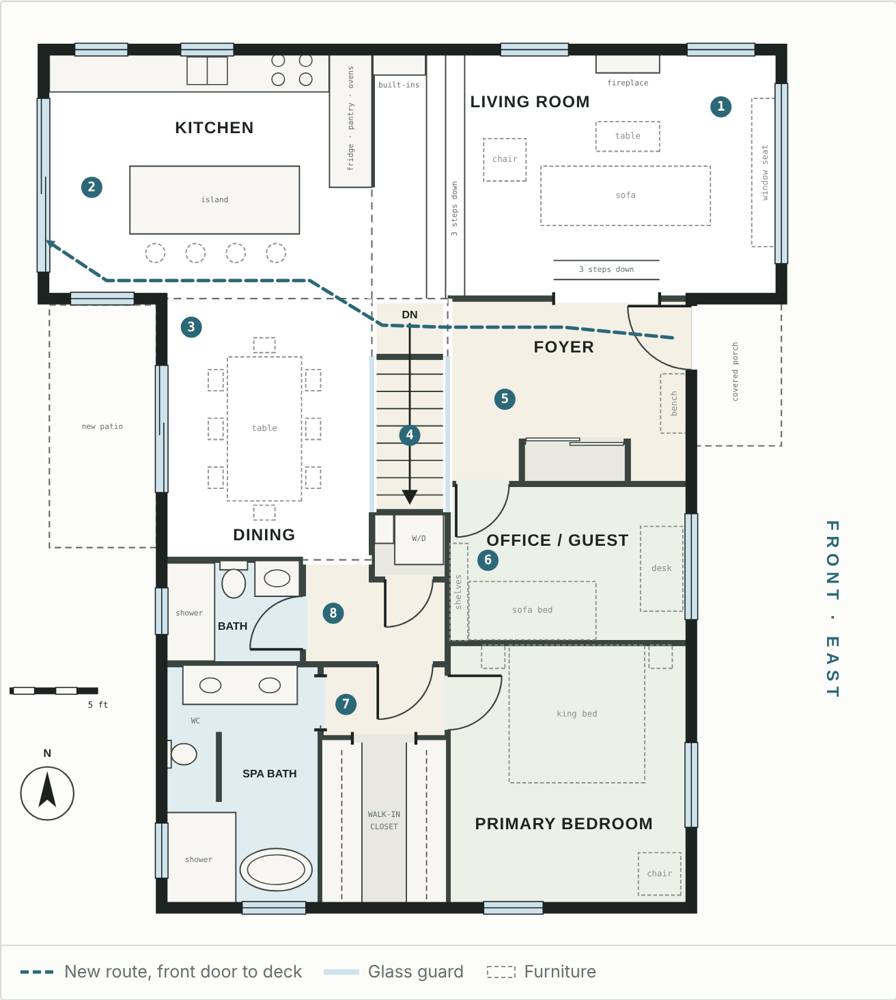

**See it in 3D:** [the dream plan model](../../renderings/2026-11-08-dream-plan/) compares it with the house today from the same camera views.

Living, kitchen and dining wrap around an open stair, the garage becomes a sunken living room, and the two south bedrooms become one primary suite. Kids, guests and a family room go downstairs.

1. **Living room in the garage.** The garage becomes a sunken living room, three steps down, since its floor is already 1½–2 ft below the house. Its rafters are already open, so it can have a vaulted ceiling. A big window with a window seat replaces the garage door, and there's a fireplace on the north wall. A raised strip along the kitchen side links the landing to the kitchen.
2. **Kitchen by the deck.** The kitchen moves to the old dining room. It has an 8-ft island with four stools, counters under the north windows, a tall wall for the fridge, pantry and ovens, and a wide glass door to the deck.
3. **Dining.** Dining takes the old kitchen spot, with new glass doors in the west wall out to the deck.
4. **Open stair.** The stair stays where it is but opens up, with glass guards on both sides and a skylight above.
5. **Foyer.** The north half of the front room becomes a real foyer, with a coat closet, a bench and a view through the glass stair to the deck doors. A covered porch shelters the front door.
6. **Office or guest room.** It takes the south half of the front room, with the front window.
7. **Primary suite.** The two south bedrooms become one suite behind a small vestibule:
   - The green room is the bedroom.
   - A 6′ × 8′ walk-in closet replaces the old closets and the flue chase.
   - Bedroom 2 becomes a spa bath with a freestanding tub, a walk-in shower, a double vanity and a toilet nook.
8. **Hall bath and laundry.** The hall bath stays for guests, refreshed with a walk-in shower. The old pantry becomes a laundry closet beside the bedrooms.

The walk from the front door to the deck drops to about **31 ft**.

- **How it feels:** you arrive in a real foyer and see straight through the glass stair to the deck doors. Daily life runs in one loop: down the steps to the fire, cooking at the island with the deck doors open, eating by the west glass. The bedroom wing sits behind a vestibule, quiet and separate.
- **Trade-offs:**
  - You give up the garage, which matters in Utah winters.
  - The main floor drops to one bedroom plus an office. It works best with a finished basement, or with the office doubling as a guest room.
  - The kitchen's new spot depends on what's under the old dining room: easy if the basement reaches that far, harder over a crawlspace or slab.
- **Checks first:**
  - Ask your city whether the garage can become living space without adding parking elsewhere, and what the new porch needs.
  - Get an engineer for the beams: the garage–dining wall, the landing and stair walls, and the vaulted ceiling.
  - Plan for the garage to need an insulated floor and walls.
- **Build notes:**
  - Plumbing for the spa bath, hall bath, laundry and the kitchen's new spot can run through the unfinished basement ceiling.
  - Replace the furnace and water heater with direct-vent units or a heat pump, and run new ducts from the basement. That removes the flue chase and the front room duct.
- **Rough cost:** this is a gut renovation of the whole main floor plus structural work.
  - [Angi](https://angi.com/articles/how-much-does-it-cost-demo-interior.htm) says most whole-house demolition-and-remodel projects run $100,000–200,000.
  - [This Old House](https://www.thisoldhouse.com/garages/garage-conversion-cost) puts most garage conversions at about $10,000–52,000.
  - With glass walls, a vaulted ceiling and custom finishes, expect the top of that range or more.
- **Variations:**
  - **Two bedrooms upstairs:** move the office door to the hall and add a closet, and it becomes bedroom 2.
  - **Somewhere to park:** a detached garage or carport, if the lot and the city allow it.
  - **A hidden stair:** concept 5's lift-up island in place of the glass guards.
- **Downstairs:** two bedrooms with egress windows, a full bath on the existing rough-in, a family room and storage. The basement needs its own measured plan first.

## 7 · Dream plan, garage kept

*Budget no object, but the garage stays a garage.*

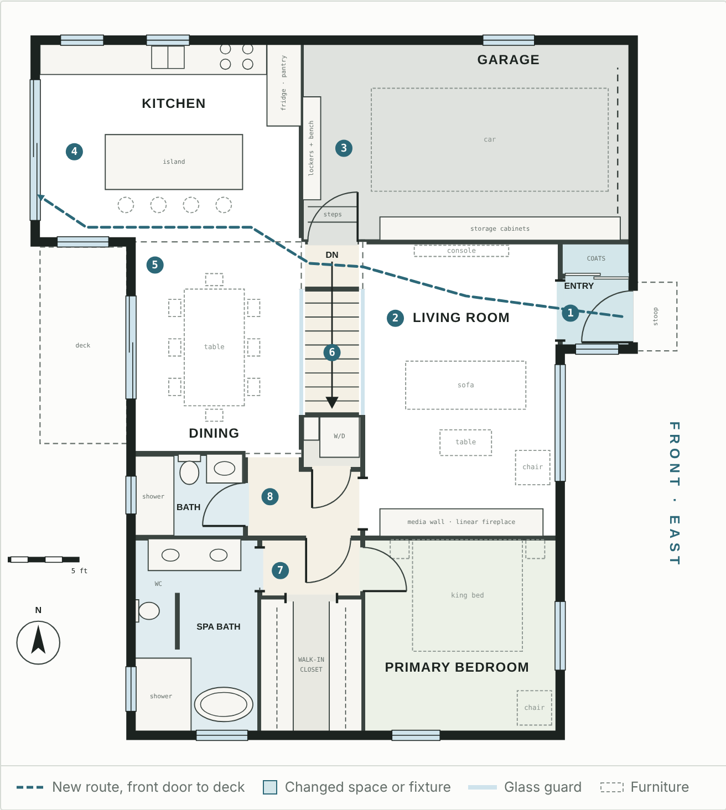

**See it in 3D:** [the garage-kept model](../../renderings/2026-11-08-dream-plan-garage-kept/) switches between today, Dream 1 and this plan from the same camera views.

The same big moves as the dream plan, but the garage is finished instead of converted. The front room stays the living room and opens up to the glass stair. A small entry addition beside the garage gives the house a real front door, and a mudroom wall in the garage handles everyday comings and goings.

1. **Entry addition.** A small addition fills the notch beside the garage, flush with its front. The front door finally faces the street, with a coat closet before you step into the living room.
2. **Living room.** The front room stays the living room but opens up: glass on the stair side, the landing wall gone, and a media wall with a linear fireplace on the south wall. The doorway to the hall stays, so you can walk a loop.
3. **Garage, finished.** It's insulated and drywalled, with:
   - an epoxy floor;
   - a new insulated door;
   - storage cabinets and an EV charger;
   - lockers with a bench by the steps into the house.
4. **Kitchen by the deck.** An 8-ft island with stools, counters under the north windows, and a tall fridge and pantry wall against the garage. The tall wall stops short of the island, so the aisle stays clear.
5. **Dining.** It takes the old kitchen spot, with glass doors out to the deck.
6. **Open stair.** Glass guards and a skylight. Coming up from the garage, you land in the middle of the house.
7. **Primary suite.** The same as concept 6: a walk-in closet and a spa bath behind a small vestibule. The bedroom keeps its current wall line.
8. **Hall bath and laundry.** The hall bath gets a walk-in shower, and the old pantry becomes the laundry closet.

The walk from the front door to the deck is about **35 ft**.

- **How it feels:** you come in through a real front door, step into the living room and see straight through the glass stair to the dining room, the kitchen and the deck. Coming home from the garage, you drop your things at the lockers and step up into the open landing at the middle of everything.
- **Trade-offs:**
  - The living room stays the size of the front room, about 11′ 6″ × 17′, so it's cozier than concept 6's.
  - The main floor has one bedroom and no office, so guests, kids and work space go downstairs, unless you keep bedroom 2 (see Variations).
  - The entry is a small addition, which means a foundation, a roof tie-in and a permit.
- **Checks first:**
  - Ask your city about setbacks for the entry addition. It lines up with the garage front, which may help.
  - Get an engineer for the beam at the landing and stair walls.
  - The garage keeps its fire-rated walls and a self-closing door into the house.
- **Rough cost:**
  - The main floor is in the same range as concept 6.
  - The entry addition adds roughly $14,000–32,000, [Angi's](https://www.angi.com/articles/entryway-addition-cost.htm) range for entryway additions.
  - Finishing the garage runs from a few thousand dollars for a floor coating, paint and storage up to [This Old House's](https://www.thisoldhouse.com/garages/garage-remodel-cost) mid-range $14,000–28,000 with insulation and a new door. That figure is for a typical two-car garage, so a one-car garage should cost less.
- **Variations:**
  - **Keep bedroom 2:** keep it as an office or guest room, and give the primary suite the old bath plus the short hall as its bathroom (concept 3).
  - **Skip the addition:** build the coat closet and a bench into the north end of the living room instead.
  - **A hidden stair:** concept 5's lift-up island in place of the glass guards.

## 8 · Fewer walls, garage kept

*Budget no object · the garage stays · every wall that isn't needed comes out.*

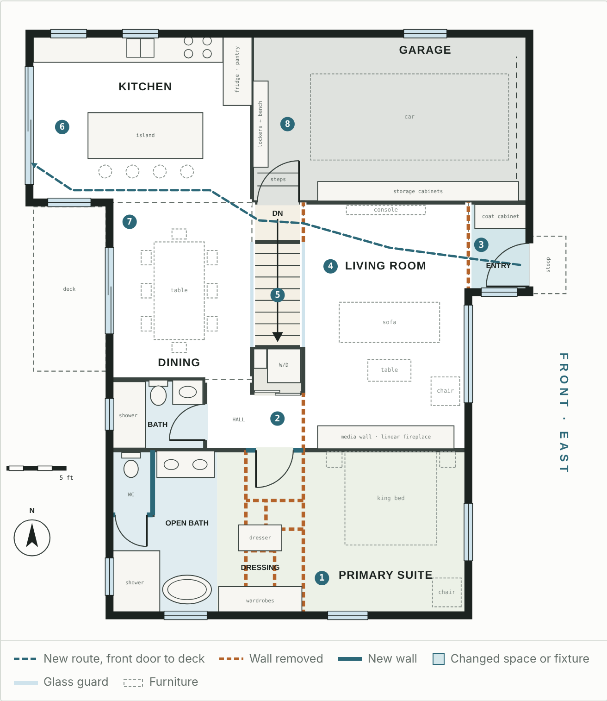

**See it in 3D:** [Dreams 3 and 4](../../renderings/2026-11-08-dream-plans-3-and-4/).

Concept 7 with every wall that isn't doing a job taken out. Walls stay only around the bedroom, the bathrooms and the toilet, at the garage, and outside. On the plan, orange dashes are today's walls that come out, and teal lines are the few new ones.

1. **Open primary suite.** One room: sleeping at the front, a dressing area with wardrobes and a dresser island in the middle, and an open bath at the back with the tub and a double vanity. Only the toilet gets its own walls, and the shower is behind glass.
2. **Hall and laundry.** The hall wall comes out, so the hall becomes part of the living room, with the suite and hall bath doors opening off it. The laundry becomes a cupboard with sliding doors.
3. **Entry.** The entry addition opens fully into the living room, with a beam where the old front wall was and a coat cabinet instead of a closet.
4. **Living room.** It keeps concept 7's media wall and linear fireplace.
5. **Stair.** Glass guards on both sides, with a skylight above.
6. **Kitchen.** By the deck, as in concept 7.
7. **Dining.** In the old kitchen spot, with glass doors to the deck.
8. **Garage.** Finished, with lockers and a bench by the door into the house.

- **Walls:** about 46 ft of interior wall comes out, plus 6 ft of the old front wall at the entry. Another 15 ft turns into glass, and only about 12 ft of new wall goes in: the suite's front wall and the toilet room.
- **How it feels:** from the front door you see across the living room, through the glass stair and the dining room, to the deck. The suite feels like a hotel suite, one long room from the bed to the tub, with daylight from three sides.
- **Trade-offs:**
  - Open rooms carry sound and smells further.
  - An open bath isn't for everyone; sliding panels between the dressing area and the bath would give privacy back when you want it.
  - More open spans mean more beams.
- **Checks first:**
  - The same as concept 7: setbacks for the entry addition, the garage's fire-rated walls, and an engineer for the beams.
  - Here there are more beams: at the old front wall at the entry, the landing, the stair walls and the hall.
- **Build notes:** an open bath needs strong, quiet exhaust over the shower and tub, on a humidity sensor.
- **Rough cost:** about the same as concept 7. Fewer walls means less framing, drywall and doors, but more beams and more finish work around the openings.

## 9 · Kitchen stays, fewer walls

*Budget no object · the garage stays · the kitchen stays where it is.*

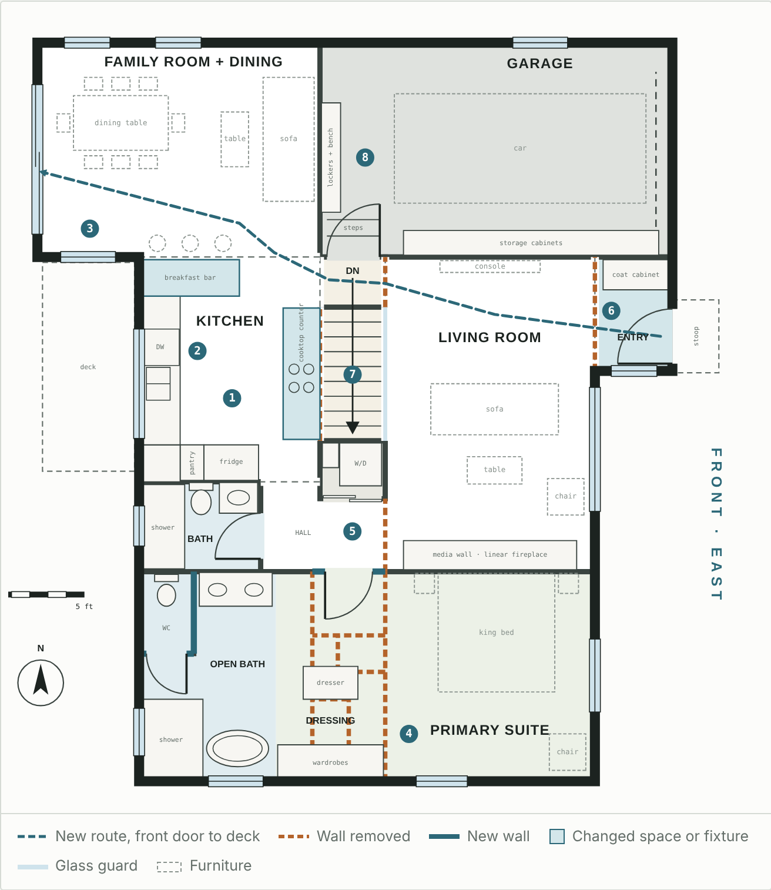

**See it in 3D:** [Dreams 3 and 4](../../renderings/2026-11-08-dream-plans-3-and-4/).

The kitchen stays where it is but opens up around a big new window in the west wall, over the sink. The rest follows concept 8: few walls and the garage kept. The bump-out by the deck becomes the family room and dining room.

1. **Kitchen in place.** A U around the new window:
   - the sink under the window;
   - a fridge and a pull-out pantry on the south wall, so the short hall from the bedrooms still opens into the kitchen;
   - a cooktop counter along the stair;
   - a breakfast bar facing the family room.
2. **The new window.** It's about 6 ft wide over the sink and looks out over the deck to the yard, bringing afternoon light into the middle of the house. It could also be a pass-through window to the deck.
3. **Family room and dining.** The bump-out gets a sofa against the garage wall, the table under the north windows, and the slider to the deck.
4. **Suite, hall, entry and garage.** The same as concept 8.
5. **Stair.** Glass on the living room side. On the kitchen side, the cooktop counter is the guard, so whoever is cooking faces the living room.

- **Walls:** about 54 ft of interior wall comes out, including the kitchen's half wall to the stair, which becomes the cooktop counter. Another 7 ft turns into glass, and only about 12 ft of new wall goes in.
- **How it feels:** the kitchen stays in the middle of the house, where it's easy to reach from everywhere. Now it's bright: daylight from the big window, a view through the stair to the living room, and the family room and deck right beside it.
- **Trade-offs:**
  - It's a working U rather than an island kitchen, with an aisle about 5′ 8″ wide.
  - The pantry is a narrow pull-out beside the fridge rather than a walk-in.
  - The cooktop on the stair counter needs a downdraft vent, so a hood doesn't block the view.
- **Checks first:** the new window needs a header in the west wall. If that wall carries the roof, an engineer sizes it.
- **Rough cost:** less than concepts 6–8, because the kitchen's plumbing stays close to where it is and the bump-out needs furniture rather than a new kitchen. Get a quote for the window header.
- **Variations:**
  - **Pass-through window:** a counter-height sliding window that opens onto the deck, with a bar ledge outside.
  - **Glass on both sides:** keep glass on the stair's kitchen side and move the cooktop to the south counter.

## 10 · Fewer walls, garage converted

*Budget no object · fewer walls · the garage becomes living space.*

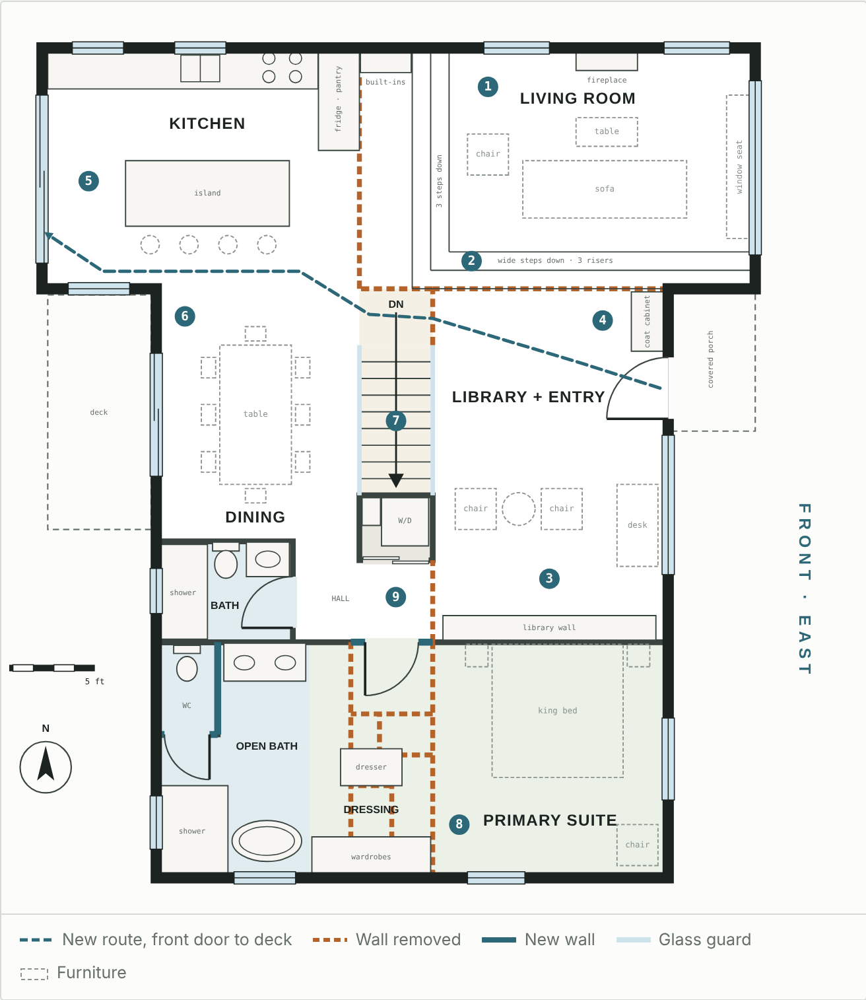

**See it in 3D:** [Dream 5](../../renderings/2026-11-08-dream-plan-5-no-garage/).

Concept 8's fewer walls, but the garage no longer has to be a garage. It becomes a sunken living room that opens straight onto the kitchen and the landing, and the front room becomes a library you walk through from the front door. Walls stay only around the bedroom, the bathrooms, the toilet and outside.

1. **Living room in the garage.** Three steps down, since the garage floor already sits about 1½ ft below the house. The rafters go, for a vaulted ceiling. A big window replaces the garage door, with a window seat under it, and a fireplace sits on the north wall between two windows.
2. **Wide steps.** The garage walls come out, so the old wall line becomes wide steps that wrap around the south and west sides of the room. You can sit on them, and they bring the living room into the landing and the kitchen.
3. **Library.** The front room becomes a library and study: books along the south wall, a desk at the picture window and two reading chairs. It's the room you walk through from the front door.
4. **Entry.** The front door stays in the notch, shifted a little south, under a new covered porch, with a coat cabinet beside it. No entry addition is needed.
5. **Kitchen.** By the deck, as in concepts 6–8, with the island facing the living room. The fridge and pantry are a freestanding cabinet block where the garage wall was, and the kitchen is open to the living room beside it.
6. **Dining.** In the old kitchen spot, with glass doors to the deck.
7. **Stair.** Glass guards on both sides, with a skylight above. The landing opens on all four sides.
8. **Suite, hall and laundry.** The open suite, open hall and laundry cupboard from concept 8.

- **Walls:** about 73 ft of interior wall comes out, including the garage walls, which no longer need to be fire-rated once it's living space. Another 15 ft turns into glass at the stair, and only about 12 ft of new wall goes in: the suite's front wall and the toilet room.
- **How it feels:** you come in under the porch into the library and look straight across the glass stair to the dining room and the deck. Turn right and the floor steps down into a big, vaulted living room with a fire at the far end. The kitchen is open to it along the west side, so whoever is cooking is part of the room.
- **Trade-offs:**
  - There's no garage, which matters in Utah winters.
  - There's no room you can close off for guests, TV noise or work. The library is a walk-through space, and sound travels across the whole north side.
  - The main floor has one bedroom, so the rest of the household goes downstairs.
- **Checks first:**
  - Ask your city whether the garage can become living space without adding parking elsewhere, and what the porch needs.
  - Get an engineer for the beams: the garage walls, the landing, the stair walls, the hall and the vaulted ceiling.
- **Build notes:** the old garage needs an insulated floor, walls and ceiling. Heat in the floor keeps a big room over a slab from feeling cold, and the fireplace can be a direct-vent gas unit.
- **Rough cost:** in the same range as concept 6, a whole-floor renovation plus a garage conversion ([Angi](https://angi.com/articles/how-much-does-it-cost-demo-interior.htm): most whole-house remodels run $100,000–200,000; [This Old House](https://www.thisoldhouse.com/garages/garage-conversion-cost): most garage conversions run about $10,000–52,000). There's no entry addition and less wall to frame and finish, but more beams.
- **Variations:**
  - **A door to close:** glass sliding doors along the top of the steps, so the library can close off as a study or guest room.
  - **Somewhere to park:** a detached garage or carport, if the lot and the city allow it.
  - **Kitchen stays:** concept 11 keeps the kitchen where it is, with the bump-out as the dining room.

## 11 · Kitchen stays, garage converted

*Budget no object · fewer walls · the garage becomes living space · the kitchen stays where it is.*

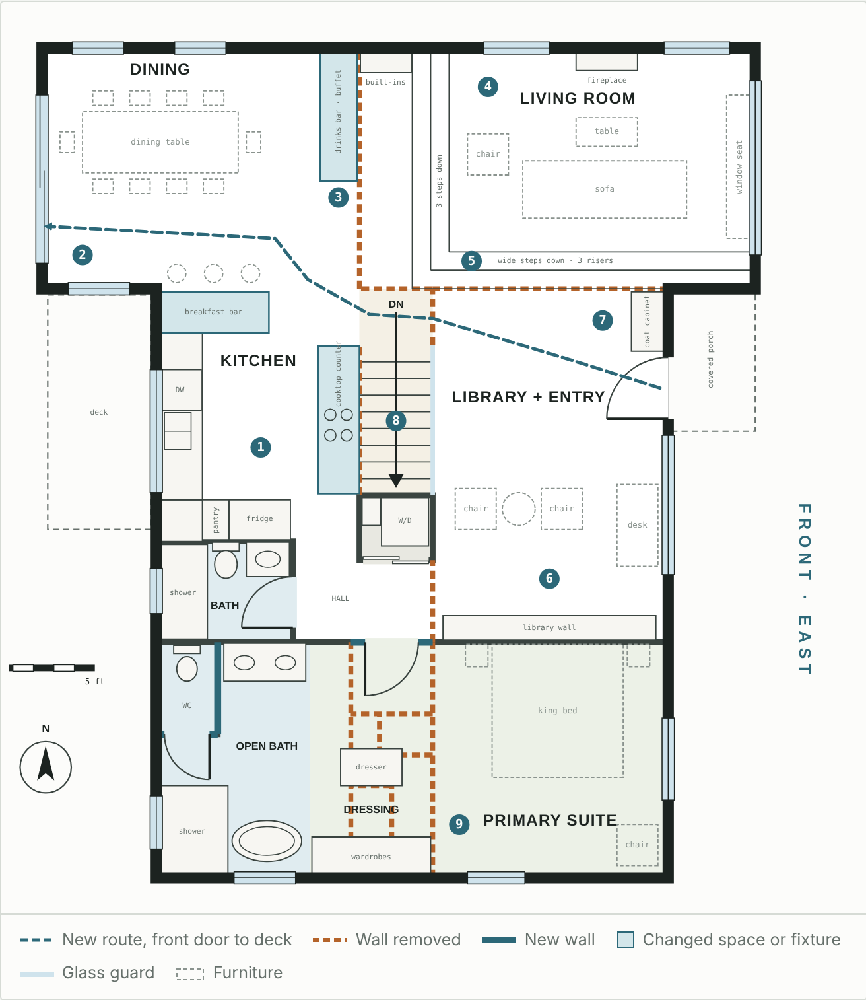

**See it in 3D:** [Dreams 6 and 7](../../renderings/2026-11-08-dream-plans-6-and-7/).

Concept 10, but the kitchen stays where it is, opened up around a big new window over the sink as in concept 9. The garage still becomes the sunken living room, the front room is still the library, and the bump-out by the deck becomes a big dining room.

1. **Kitchen in place.** A U, as in concept 9:
   - the sink under a new window about 6 ft wide;
   - a fridge and a pull-out pantry on the south wall, beside the short hall, which stays open;
   - a cooktop counter along the stair;
   - a breakfast bar facing the dining room.
2. **Dining room.** The bump-out gets a table for ten under the north windows, with the slider to the deck at the end.
3. **Drinks bar.** A low drinks bar and buffet stands where the garage wall was. It serves the dining room and the living room and keeps the view open between them.
4. **Living room.** The garage becomes the living room, as in concept 10: three steps down, a vaulted ceiling, a window seat where the garage door was, and a fireplace between two windows.
5. **Wide steps.** They wrap the south and west sides of the living room.
6. **Library.** The front room, with books along the south wall and a desk at the picture window.
7. **Entry.** The front door stays in the notch, under a covered porch, with a coat cabinet beside it.
8. **Stair.** Glass on the library side. On the kitchen side, the cooktop counter is the guard, so whoever is cooking faces the library.
9. **Suite, hall and laundry.** The open suite, open hall and laundry cupboard from concept 8.

- **Walls:** about 80 ft of interior wall comes out: concept 10's 73 ft plus the kitchen's half wall to the stair, which becomes the cooktop counter. Another 7 ft turns into glass, and only about 12 ft of new wall goes in.
- **How it feels:** the kitchen stays at the center of the house: the library across the stair, the dining room and the deck beside it, and the living room a few steps down.
- **Trade-offs:**
  - It's a working U rather than an island kitchen, and the pantry is a pull-out beside the fridge.
  - The kitchen sees the living room only across the dining room or the landing, not straight on as in concept 10.
  - There's still no garage.
- **Checks first:** the same as concept 10, plus a header for the new kitchen window.
- **Build notes:** keeping the kitchen in place keeps the sink, power and gas close to where they are now. The cooktop counter needs a downdraft vent ducted through the basement.
- **Rough cost:** less than concept 10, because the kitchen's plumbing stays close to where it is. It's still a whole-floor renovation plus a garage conversion.
- **Variations:**
  - **Two bedrooms:** concept 12.
  - **A family room:** a sofa and a TV in the bump-out with a smaller table, keeping the old garage as the quieter living room.

## 12 · Kitchen stays, two bedrooms

*Budget no object · fewer walls · the garage becomes living space · the kitchen stays · two bedrooms on the main floor.*

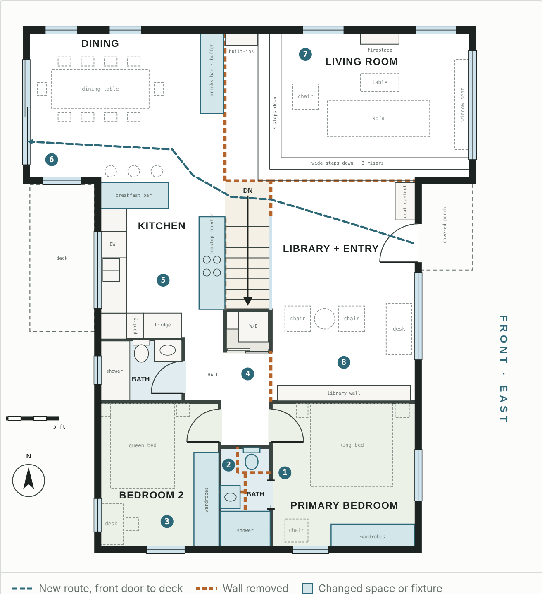

**See it in 3D:** [Dreams 6 and 7](../../renderings/2026-11-08-dream-plans-6-and-7/).

Concept 11 with two bedrooms on the main floor instead of one open suite. The bedrooms keep the walls they have now, and the closets, linen closet and flue chase between them become a small bathroom for the primary bedroom. Everywhere else, the walls that aren't needed come out.

1. **Primary bedroom.** The green room. Wardrobes along the south wall replace its closet, and a pocket door in the west wall opens to its own bathroom.
2. **Primary bath.** The closets, the linen closet and the flue chase between the bedrooms become a bath about 4 × 8 ft, about the size of today's hall bath. It has a shower across the south end, a vanity and a toilet.
3. **Bedroom 2.** It keeps its size, with wardrobes on the east wall, room for a queen bed, and a desk under the west window. It shares the hall bath with guests.
4. **Hall.** It stays open to the library, and the laundry is a cupboard. Both bedroom doors open off a small nook at the end of the hall.
5. **Kitchen.** In its current spot around the new window, as in concept 11.
6. **Dining room.** In the bump-out, with the drinks bar and buffet on the old garage wall line.
7. **Living room.** The sunken living room in the old garage, with wide steps on two sides.
8. **Library and entry.** The front room, with the front door under a covered porch.

- **Walls:** about 54 ft of interior wall comes out: the closets, linen closet and flue chase between the bedrooms, the hall wall, the landing wall, the garage walls and the kitchen's half wall. Another 7 ft turns into glass. No new walls go in, because both bedrooms keep the walls they have now.
- **How it feels:** the bedrooms stay private rooms with doors at the end of an open hall. Everything else is one connected space.
- **Trade-offs:**
  - The primary bath is small, with a shower rather than a tub.
  - The closets become wardrobes inside the rooms.
  - Bedroom 2 and guests share the hall bath.
  - There's still no garage.
- **Checks first:** the primary bath only fits once the flue chase is gone, so the furnace and water heater need to be direct-vent units or a heat pump (concept 4). Otherwise the same as concept 11.
- **Build notes:** the new bath's drains and supply run down to the unfinished basement, next to the hall bath's. Use a quiet exhaust fan on a humidity sensor.
- **Rough cost:** about the same as concept 11. Keeping the bedroom walls saves framing and finishing, but the new bathroom adds plumbing, tile and fixtures.
- **Variations:**
  - **A bigger primary bath:** take 2–3 ft from bedroom 2 for a roomier bath with a tub. Bedroom 2 would drop to about 7 × 11½ ft.
  - **Kitchen by the deck:** concept 10's kitchen also works with two bedrooms.

## 13 · Dream 7, refined

*Your idea: Dream 7 with a clear way into the kitchen and a stairwell that changes.*

**See it in 3D:** [Dream 7 refined](../../renderings/2026-11-08-dream-7-refined/), with switches for the three stairwell settings, the garage and the pantry.

Dream 7 with the kitchen and the stair refined. The island is shorter and starts further from the bedroom hall, so the way into the kitchen is clear. The old pantry is a pantry again. And the stairwell has three settings: a stair, a big work table, or extra floor.

| Stair | Big table | Extra floor |
|---|---|---|
| 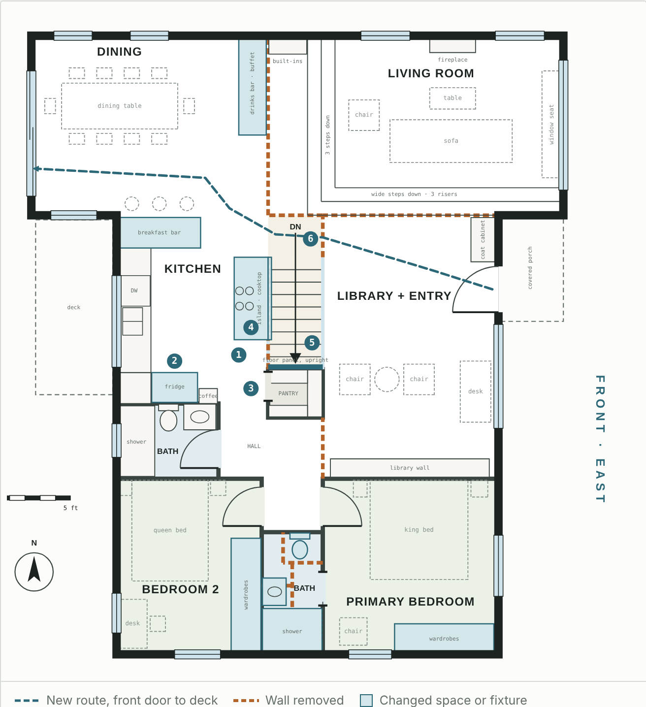 | 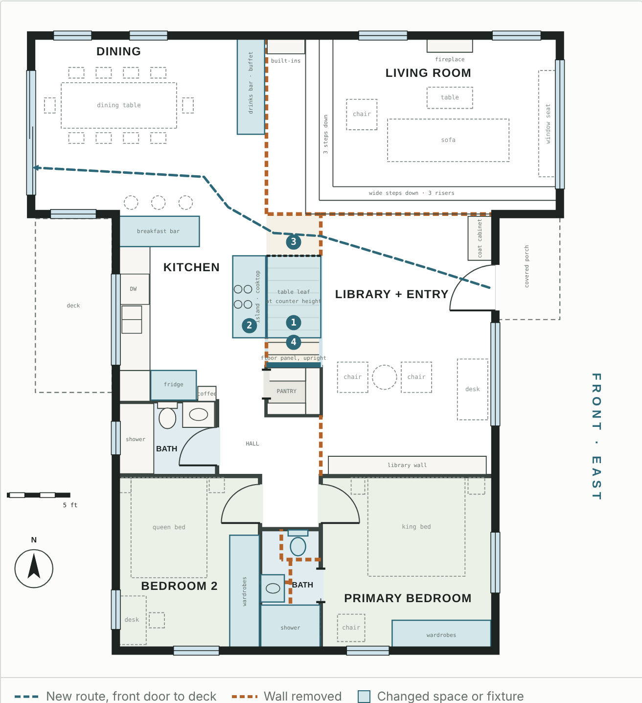 | 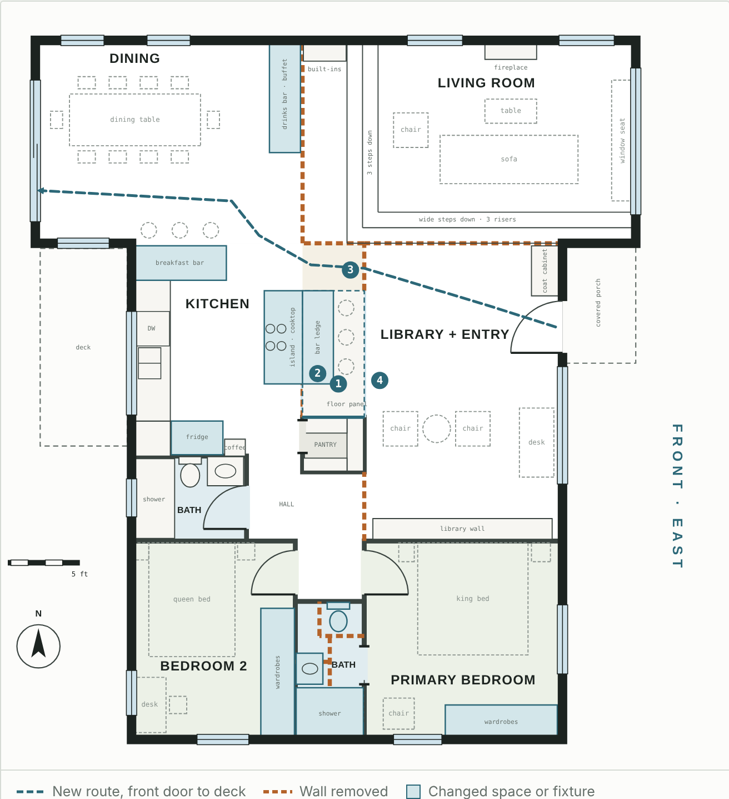 |

**The kitchen and pantry**

1. **A clear way in.** The island now starts about 4 ft from the bedroom hall instead of 2, and it's shorter, so you walk straight out of the hall into the kitchen. Glass fills the gap along the stair.
2. **Fridge.** It moves a step west, clear of the way in, with a coffee shelf in the corner by the hall.
3. **Pantry.** The old pantry is a pantry again, open to the kitchen, with shelves on three sides. The laundry goes in the basement.
4. **Island.** It keeps the cooktop on its kitchen side. A leaf, folded in half, hangs on its stair side, ready to fold out.

**The stairwell's three settings**

- **Stair (most days):** the stair works as it does now, with glass on the library side and the island as the guard on the kitchen side. The floor panel stands upright at the bottom end of the stairwell, against the back of the pantry. Its underside can be a chalkboard or a pinboard.
- **Big table:** the leaf unfolds across the stairwell and rests on the library-side rail, which is set at counter height. With the island, that's a work surface of about 31 sq ft, with the cooktop still usable at the kitchen edge. A gate closes the top of the stair while the leaf is out.
- **Extra floor:** the floor panel folds down from the back of the pantry, counterbalanced like a wall bed, and lands flush on ledges around the stairwell. That adds about 26 sq ft of floor. Half of the leaf folds up as a bar ledge with room for three stools, so guests sit across from the cook, and the new floor opens onto the landing.

- **Walls:** the same as concept 12: about 54 ft comes out and no new walls go in. About 9 ft turns into glass.
- **How it feels:** you come out of the bedroom hall onto open kitchen floor instead of jogging around the corner of a counter. Most days the stair is just a stair. On a big cooking day the middle of the house becomes a kitchen table, and when people come over it becomes floor.
- **Trade-offs:**
  - While the leaf or the floor is down, the stair is closed, so the basement needs its own way out if anyone sleeps there.
  - The panels need custom building and good hardware.
  - The island is about 2 ft shorter than concept 12's cooktop counter.
  - The laundry goes in the basement.
- **Code questions:** closing off the only stair to the basement is the inspector's call, as with concept 5. Expect to need:
  - egress windows in the basement bedrooms;
  - panels that open from below without power or tools;
  - a gate or an interlock at the top of the stair;
  - guards on every open edge whenever the stair is in use.
- **Build notes:**
  - The leaf is two butcher-block halves joined by a piano hinge, hung from the island's stair edge, with fold-out steel brackets for the bar ledge.
  - The floor panel is built like a floor, rated for about 40 lb per sq ft, on a counterbalanced hinge like a wall bed's, landing on steel angles around the stairwell.
  - My estimate is 150–250 lb for the floor panel, so the counterbalance matters.
- **Rough cost:** concept 12's costs, plus custom carpentry, metalwork and hardware for the two panels. I couldn't find published prices for this kind of build. My rough guess is $4,000–12,000 for both, built by a pro.
- **Variations:**
  - **Glass that opens:** library-side glass panels that pivot open in the floor setting, locked closed whenever the stair is open.
  - **A sliding leaf:** a telescoping leaf under the island's top instead of a folding one. The cooktop would move to the west counter.
  - **Just one:** the floor panel alone for party space, or the leaf alone for the work table.

**With the garage kept**

The page also has a **Garage** switch: living room (as above) or garage. Every stairwell setting works either way.

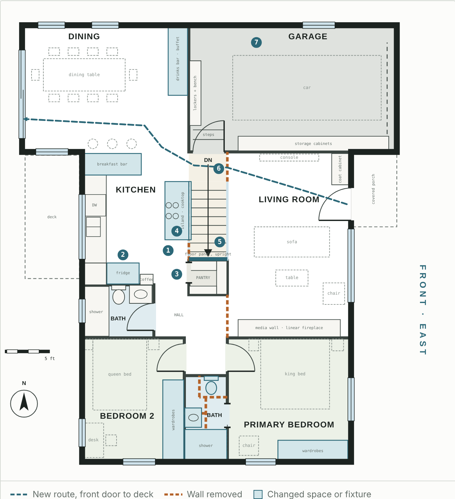

- **Garage:** finished as in concept 7: insulated, with an epoxy floor, a new insulated door, storage, an EV charger, and lockers with a bench by the steps up to the landing. It keeps its fire-rated walls and a self-closing door to the landing.
- **Front room:** it goes back to being the living room, with a media wall and a linear fireplace. There's no library.
- **Walls:** about 27 ft comes out instead of 54, since the garage walls stay. About 9 ft turns into glass, and no new walls go in.
- **Trade-off:** you keep the garage but lose the big sunken living room. The living room is the front room, about 11½ × 17 ft.
- **Rough cost:** less than converting the garage. Finishing it runs from a few thousand dollars up to [This Old House's](https://www.thisoldhouse.com/garages/garage-remodel-cost) mid-range $14,000–28,000 for a typical two-car garage, against about $10,000–52,000 for most [garage conversions](https://www.thisoldhouse.com/garages/garage-conversion-cost).

**With a walk-in pantry**

A third switch, **Pantry**, trades a bathroom for a much bigger pantry. Every stairwell and garage setting works with either pantry.

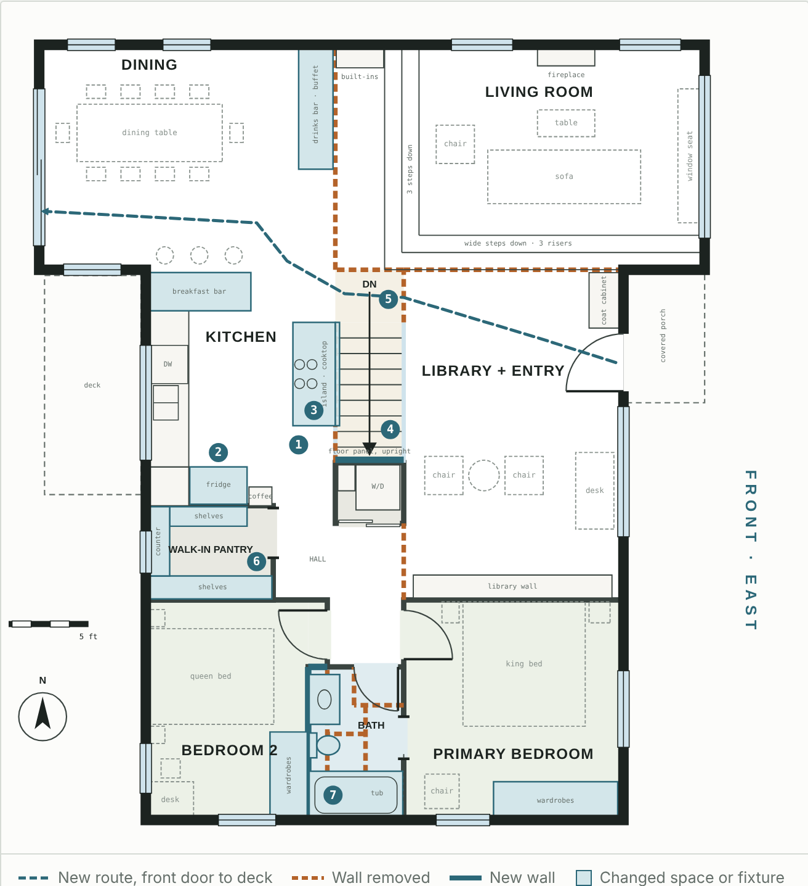

- **Walk-in pantry:** the hall bath becomes a pantry of about 33 sq ft, three times the reach-in one. It has shelves on two walls, a counter for small appliances and its own window. It opens off the short hall, a step from the kitchen.
- **Laundry:** the old pantry goes back to being the laundry cupboard.
- **One shared bath:** the bath between the bedrooms grows a foot into bedroom 2, to a 5 × 8 ft bath with a tub. It becomes the main bath, with doors from the hall and from the primary bedroom.
- **Bedroom 2:** it gives up about 8 sq ft, and its bed moves to the west wall.
- **Walls:** about 62 ft comes out with the garage as living space, or about 35 ft with the garage kept. About 9 ft of new wall goes in for the wider bath.
- **Trade-off:** one bathroom on the main floor instead of two, shared by both bedrooms and guests, and the primary bedroom no longer has a bath of its own. The basement already has a plumbing rough-in for a second bath.
- **Rough cost:** about the same as the reach-in version. The hall bath's plumbing is capped rather than redone, and the middle bath is a little bigger.

## 14 · Garage kitchen

*Your idea: the garage becomes the kitchen. Built on concept 13.*

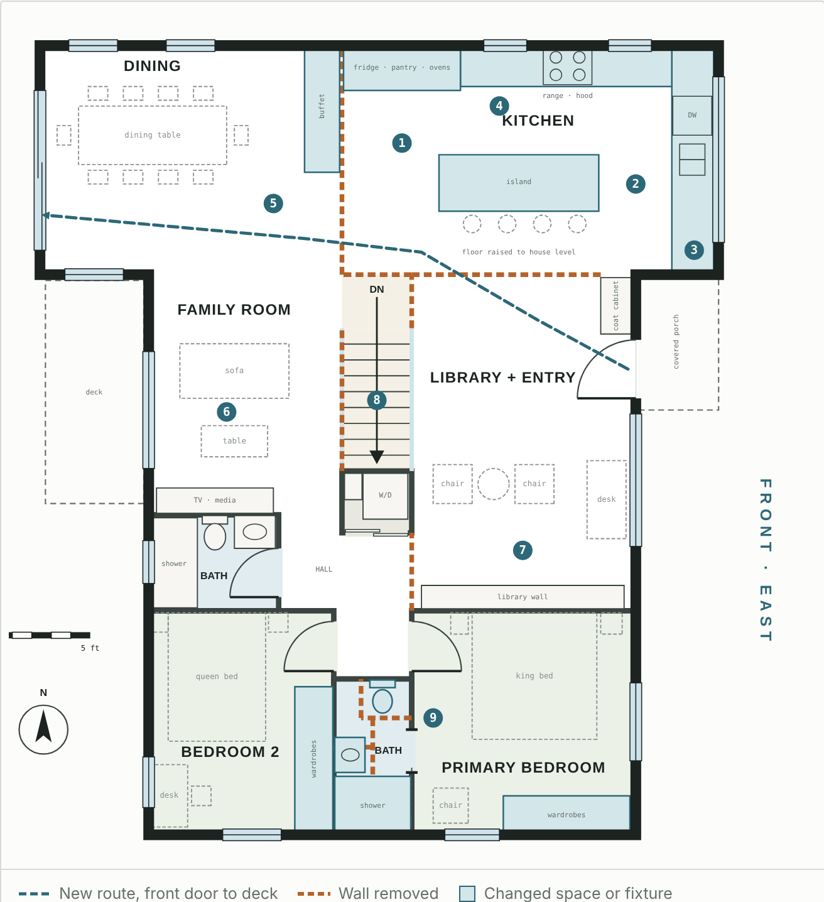

**See it in 3D:** [Dream 8, the garage kitchen](../../renderings/2026-11-09-garage-kitchen/).

Dream 7 refined, but the garage becomes the kitchen. Its floor comes up to the level of the house and its ceiling opens to the rafters, so the biggest room in the house becomes a vaulted kitchen with a big island. It opens onto the dining room by the deck and the library by the front door, and the old kitchen becomes a family room.

1. **The garage becomes the kitchen.** Its floor comes up about 1½ ft to the level of the house on a new framed floor, which carries the drains, gas and ducts, so there are no steps. The ceiling opens to the rafters.
2. **Island.** An 8-ft island with four stools sits in the middle, facing the range, under pendants hung from the vaulted ceiling.
3. **Sink window.** The garage door becomes a wide window over the sink, looking out to the street and the morning sun, with a planter outside.
4. **Range and tall wall.** The range sits between two windows on the north wall. A tall wall beside it holds the fridge, the pantry and the ovens.
5. **Dining room.** The garage wall to the bump-out comes out, so the dining room is right beside the kitchen, with a low buffet between them and the slider to the deck at the far end.
6. **Family room.** The old kitchen becomes a family room: a sofa facing a media wall, and a big new window over the deck.
7. **Library and entry.** The front room stays the library. Its north wall comes out, so the kitchen opens straight off it, a few steps from the front door.
8. **Stair.** Glass on both sides, now that the kitchen has moved away from it.
9. **Bedrooms.** The two bedrooms, the small primary bath and the open hall from concept 12, with the laundry cupboard back.

- **Walls:** about 52 ft of interior wall comes out. About 15 ft turns into glass at the stair, and no new walls go in.
- **How it feels:** the kitchen becomes the center of the house. From the front door you look through the library straight into it, groceries travel about 15 ft, and the dining room and deck are right beside it. The old kitchen becomes a quieter family room for TV.
- **Trade-offs:**
  - There's no garage, and the kitchen's big window faces the street.
  - Everything about the kitchen is new: plumbing, gas, venting and electrical all have to reach a room with no basement under it.
  - There's no big sunken living room; the library and the family room share that job.
- **Checks first:** whether the city allows the garage to become living space without parking elsewhere; an engineer for the beams and the new raised floor; a plumber to confirm the drains can reach the basement with enough slope.
- **Build notes:** the raised floor leaves a crawl space for the drains, the gas line, the hood duct and the heat. The hood vents up through the roof, and the sink drain runs through the foundation wall into the basement.
- **Rough cost:** the most of any plan: a whole-floor renovation, a garage conversion with a new raised floor, and an all-new kitchen in a room that has none of the services yet. Most whole-house remodels run $100,000–200,000 ([Angi](https://angi.com/articles/how-much-does-it-cost-demo-interior.htm)), and most garage conversions about $10,000–52,000 ([This Old House](https://www.thisoldhouse.com/garages/garage-conversion-cost)), before the kitchen itself.
- **Variations:**
  - **Keep the floor sunken:** leave the kitchen three steps down. It saves the new floor, but every trip to the table crosses steps, and the drains have to be cut into the slab.
  - **A front kitchen garden:** a planted courtyard with a low wall in front of the sink window.
  - **The stairwell settings:** concept 13's fold-down floor still works here; the table leaf needs an island beside the stair, so it doesn't.

## 15 · Dream 9: the big pantry

*Your idea: Dream 7 refined, reworked to make room for a big pantry. Built on concept 13.*

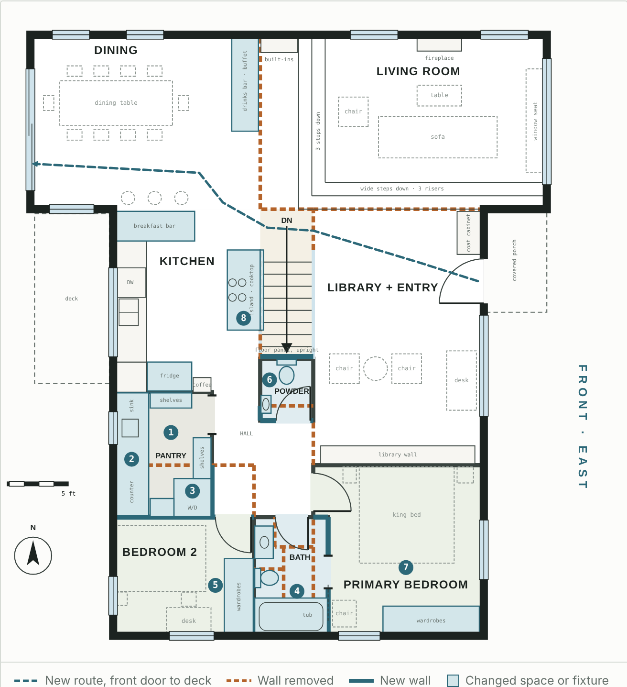

**See it in 3D:** [Dream 9, the big pantry](../../renderings/2026-11-09-dream-9-big-pantry/).

Dream 7 refined, with the bedroom end reworked around a big working pantry. The pantry takes the hall bath and the north end of bedroom 2: about 56 sq ft, with a prep sink, shelves on three walls and the laundry. The bath between the bedrooms grows into the shared full bath, the old pantry becomes a powder room, and both bedrooms get a little smaller.

1. **Pantry.** The hall bath and the north 3½ ft of bedroom 2 become a working pantry of about 56 sq ft, five times the old one. It opens off the hall, a step from the kitchen.
2. **Counter and prep sink.** A counter runs the length of the west wall, with a prep sink under the window and room for the small appliances.
3. **Laundry.** The washer and dryer stack in a closet in the corner, so the laundry stays on the main floor.
4. **Shared bath.** The bath between the bedrooms grows a foot into the primary bedroom, to 5 × 8 ft with a tub. It has a door from the hall and a pocket door from the primary bedroom.
5. **Bedroom 2.** About 9½ × 8 ft: a full bed against the west wall, wardrobes, and a desk under the window. Its door moves to the new short hall.
6. **Powder room.** The old pantry and a foot of the hall become a powder room for guests, leaving a 3 ft way through from the library to the bedrooms.
7. **Primary bedroom.** A foot narrower, about 10½ × 11½ ft, with its king bed and wardrobes.
8. **Kitchen and stairwell.** The same as concept 13, including the stairwell's three settings (the switch on the interactive page).

- **Walls:** about 77 ft of interior wall comes out, including the closets between the bedrooms, the walls around bedroom 2 and the hall bath, and the garage walls. About 27 ft of new wall goes in for the pantry, the short hall, the shared bath and the powder room. About 9 ft turns into glass at the stair.
- **How it feels:** groceries go from the front door through the library and straight into the pantry, a step from the kitchen. Small appliances, bulk food and the laundry live behind one opening, so the kitchen counters stay clear. The bedrooms have a short hall of their own, with a powder room out front for guests.
- **Trade-offs:**
  - Bedroom 2 drops from about 109 to 76 sq ft: room for a full bed, wardrobes and a desk, but not a queen.
  - The primary bedroom is a foot narrower and loses its own bath, so the main floor has one full bath plus a powder room.
  - The laundry shares the pantry, and the stair is still closed while the table or the floor is in use.
- **Checks first:** that bedroom 2 meets your city's minimums (usually 70 sq ft and 7 ft in any direction); that the prep sink and washer can reuse the hall bath's lines and the powder room can tie into the stack; and concept 13's checks.
- **Rough cost:** about the same as concept 13. You skip the hall bath remodel (its surround is failing anyway) and add a powder room and a pantry sink, which roughly balance. The stairwell panels still add roughly $4,000–12,000 (my guess).
- **Variations:**
  - **Keep a queen in bedroom 2:** take 2 ft from bedroom 2 instead of 3½. The pantry shrinks to about 43 sq ft, and bedroom 2 stays about 9½ × 9½ ft.
  - **Laundry downstairs:** the pantry gets its whole southeast corner back for a tall fridge or freezer.
  - **Keep the garage:** concept 13's garage switch works here too; the bedroom end doesn't change.

## 16 · Dream 10: a calmer bedroom hall

*Your idea: clean up where the bedrooms, the pantry, the powder room and the living-room doorway meet. Built on concept 15.*

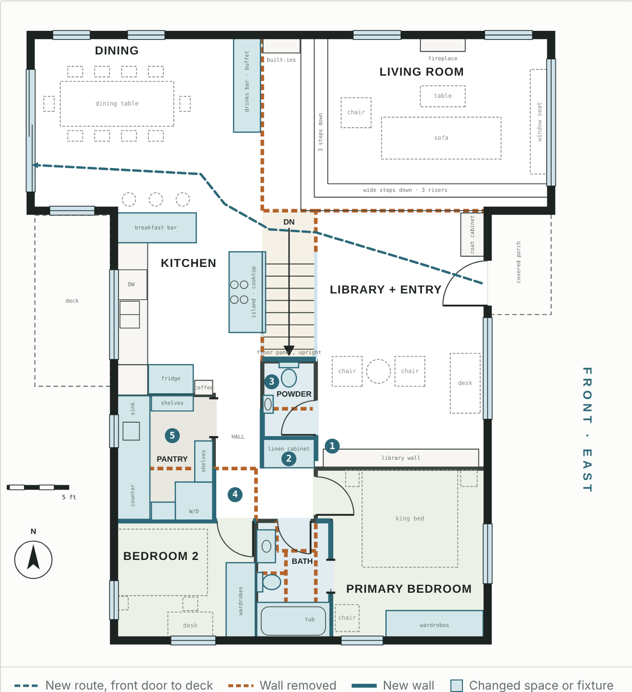

**See it in 3D:** [Dream 10, a calmer bedroom hall](../../renderings/2026-11-09-dream-10-calmer-bedroom-hall/).

In concept 15, seven openings share about 50 sq ft of hall: the kitchen, the pantry, bedroom 2, the bath, the primary bedroom, the powder room and the doorway from the library (today's living-room doorway). Concept 16 closes the doorway from the library, so the bedroom end becomes a private wing off the kitchen.

1. **Doorway closed.** The doorway from the library closes. The bedroom hall now has one way in, from the kitchen, and nobody passes through it on the way to somewhere else.
2. **Linen cabinet.** A full-height built-in, 3½ ft wide and 2 ft deep, takes its place, facing the bedroom hall. The house has had no linen closet since wardrobes replaced the closets.
3. **Powder room.** Back at full size, about 3½ × 5 ft, with its door off the library, so guests use it from the entry and never walk into the bedroom hall.
4. **Flush doors.** The bedroom hall is a simple L off the kitchen. The doors to the bath and both bedrooms are flush, full height and painted the wall color, so they read as one quiet wall, with a picture at the end on the pantry wall.
5. **Everything else** is the same as concept 15: the big pantry, the shared bath, both bedrooms, the kitchen and the stairwell's three settings.

- **Walls:** about 74 ft of interior wall comes out. About 31 ft of new wall goes in for the pantry, the short hall, the shared bath, the linen cabinet and the powder room, and to fill in the old doorway from the library. About 9 ft turns into glass at the stair.
- **How it feels:** the bedroom end becomes a private wing. Nobody cuts through it, and guests reach the powder room from the entry without passing a bedroom door.
- **Trade-offs:**
  - From the front door to the bedrooms you go through the kitchen, about 15 ft further than in concept 15.
  - The library loses its door to the bedroom end, so it's quieter but one step further from the bedrooms.
  - Everything concept 15 gives up still applies: bedroom 2 is about 76 sq ft, and the main floor has one full bath plus a powder room.
- **Checks first:** the same as concept 15. The full-height doors need 8-ft slabs and concealed hinges, which cost more and take more care to hang.
- **Rough cost:** about the same as concept 15, plus roughly $3,000–8,000 for the linen cabinet and the full-height doors (my guess).
- **Variations:**
  - **Close the kitchen end instead:** keep the doorway from the library and close the hall from the kitchen. The pantry takes that bit of hall and grows to about 70 sq ft, opening straight off the kitchen, and the bedrooms are reached from the library, as today. Getting from the kitchen to the bedrooms then means going around the stair, about 30 ft instead of 14.
  - **Jack-and-Jill bath:** open the bath from both bedrooms and drop its hall door. Guests use the powder room, but anyone sleeping downstairs would shower through a bedroom.
  - **Why the primary bedroom keeps its door alcove:** moving its door a foot east would let the hall run straight, but the door would then swing into the king bed.

## How they fit together

- **Now:** concept 1 costs little and can be undone. Living in the back for a while also shows how much you really want concept 2.
- **As one project:** concepts 2 and 3 use the same trades (an engineer, framing, drywall, plumbing and electrical), so they're cheaper and less disruptive done together. The bath needs rebuilding anyway because the surround is failing. Concept 5 is a bolder version of concept 2's stairwell, so choose between them before the framing starts.
- **Or go all in:** the dream plans (6 to 16) replace concepts 1–5 rather than adding to them, so pick one. If that's where you want to end up, skip the in-between steps it would undo. Finish the basement first so you have somewhere to live, then do the main floor in one go.
- **When it's due:** concept 4 waits for the furnace or water heater to need replacing.

## Also worth a look

- **Light in the hall:** a solar tube in the windowless hall (about $600–1,000 installed). The hall ceiling already needs patching.
- **The basement:** it's unfinished and already plumbed for a second bath. Finishing it is the biggest space gain available, and it needs its own measured plan first.
- **The end of the hall:** the linen closet door swings out into the hall between the two bedroom doors. A bifold door or open shelving would make that end feel less crowded.

## Sources for the cost ranges

These are national ranges for rough comparison, not quotes.

- [HomeGuide: cost to remove a wall](https://homeguide.com/costs/cost-to-remove-a-wall)
- [HomeGuide: stair railings and balusters](https://homeguide.com/costs/cost-to-install-stair-railings-and-balusters)
- [This Old House: small bathroom remodel cost](https://www.thisoldhouse.com/bathrooms/small-bathroom-remodel-cost)
- [ContractorPlus: relocating an electrical panel](https://contractorplus.app/resources/construction-costs/relocate-electrical-panel/boise-id)
- [Angi: cost to reroute ductwork](https://angi.com/articles/cost-to-reroute-air-ducts.htm)
- [Angi: solar tube cost](https://angi.com/articles/how-much-solar-tubes-cost.htm)
- [Murphy Door: hidden door cost](https://murphydoor.com/blogs/posts/how-much-does-a-hidden-door-cost)
- [Progressive Automations: stairwell hatch build](https://www.progressiveautomations.com/en-se/blogs/stories/stairwell-conversion-into-a-pantry-with-a-hidden-door-entrance)
- [Angi: cost to gut a house](https://angi.com/articles/how-much-does-it-cost-demo-interior.htm)
- [This Old House: garage conversion cost](https://www.thisoldhouse.com/garages/garage-conversion-cost)
- [Angi: entryway addition cost](https://www.angi.com/articles/entryway-addition-cost.htm)
- [This Old House: garage remodel cost](https://www.thisoldhouse.com/garages/garage-remodel-cost)
- [Dwell: a secret stair hatch](https://www.dwell.com/article/how-they-pulled-it-off-a-secret-stair-hatch-that-seals-off-the-living-space-6955a961)
