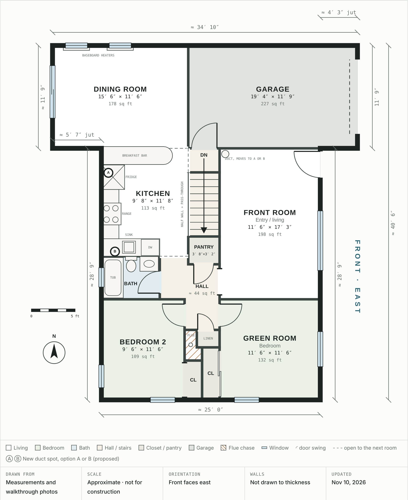

# House Floor Plan

The main-floor plan of the house as it is today, before renovation. It's drawn from hand measurements and updated (Nov 8, 2026) from the [walkthrough photos](../photos/). It matches the [baseline 3D model](../renderings/2026-11-08-baseline/).

**Open `index.html` in a browser** to see the interactive version. Hovering a room highlights it in both the drawing and the room schedule.

The **[basement plan](basement/)** (Nov 10, 2026) is in `basement/`.

## Overview

- **Orientation:** the front of the house faces east. The bedrooms are on the south side, and the garage and dining room are on the north side.
- **Main floor:** about 881 sq ft of rooms, not counting the garage. There are 2 bedrooms and 1 bath on this floor.
- **Garage:** 227 sq ft. It sticks out about 4′ 3″ past the front wall, and its back wall lines up with the west side of the stairs.
- **Dining room:** it bumps out about 5′ 7″ past the back (west) wall of the kitchen.
- **Overall size:** about 34′ 10″ east–west (along the north wall) × 40′ 6″ north–south.

## What's drawn

- **Doors**, with their swing:
  - The front door, at the north end of the front wall beside the garage.
  - The two bedroom doors, facing each other at the south end of the hall.
  - The bathroom, linen closet and pantry doors.
  - The door from the stair landing to the garage.
  - The garage door.
- **Closets:** bypass sliding doors on the green room closet, and an open, doorless closet in bedroom 2.
- **Openings:** a cased opening between the front room and the hall. The kitchen is open to the hall, the dining room and the landing.
- **Windows:**
  - Front: the picture window and the green room slider.
  - South: one window in each bedroom.
  - Back: bedroom 2 and the bathroom.
  - North: two in the dining room.
  - The patio slider from the dining room to the deck.
- **Half wall:** the half wall with a pass-through between the kitchen and the stairs. The front room side of the stairwell is a solid wall.
- **Fixtures:**
  - Kitchen: the counters, sink, dishwasher, range, fridge and breakfast bar.
  - Bathroom: the tub, toilet and vanity.
  - The live duct in the front room corner, and the two baseboard heaters in the dining room.
- **Duct move, options A and B** (circled letters, proposed): where the front room duct could come up instead, inside a kitchen cabinet on the west wall. **A** is at the north end of the west counter, where the fridge is today. **B** is in the southwest corner cabinet, beside the drain stack. Both carry on to the attic and reconnect to the attic ducts there. The routes underneath and the duct sizes are on the [basement plan](basement/#moving-the-supply-riser-phase-2).
- **The flue chase** (hatched): between the linen closet and bedroom 2, with the flue pipe from the basement.

## Room schedule

Sizes are east–west × north–south.

| Room | Size | Sq ft |
|---|---|---:|
| Front room (entry / living) | 11′ 6″ × 17′ 3″ | 198 |
| Kitchen | 9′ 8″ × 11′ 8″ | 113 |
| Dining room | 15′ 6″ × 11′ 6″ | 178 |
| Green room (bedroom) | 11′ 6″ × 11′ 6″ | 132 |
| Green room closet | 2′ × 6′ | 12 |
| Bedroom 2 | 9′ 6″ × 11′ 6″ | 109 |
| Bedroom 2 closet | 2′ × 4′ 6″ | 9 |
| Bathroom | 6′ 8″ × 4′ 11″ | 33 |
| Pantry | 3′ 8″ × 3′ 2″ | 12 |
| Linen closet* | 2′ 7″ × 2′ | 5 |
| Hall, main section | 4′ × 7′ 6″ | 30 |
| Hall, short section | 2′ 8″ × 5′ 3″ | 14 |
| Stair opening (down to basement) | 3′ 7″ × 7′ 4″ | 26 |
| Top landing (door to garage) | 3′ 7″ × 2′ 8″ | 10 |
| **Main floor total** | | **≈ 881** |
| Garage | 19′ 4″ × 11′ 9″ | 227 |

\* Estimated from the photos, not measured.

## Notes

- Walls aren't drawn to their real thickness. A few rooms are stretched or shrunk by up to about 9″ in the drawing so the walls meet, but the schedule uses the measured sizes.
- Window widths are estimated from the photos. Measure them before ordering blinds or replacement windows.
- The basement isn't drawn yet. It's unfinished and is plumbed for a second bathroom.
