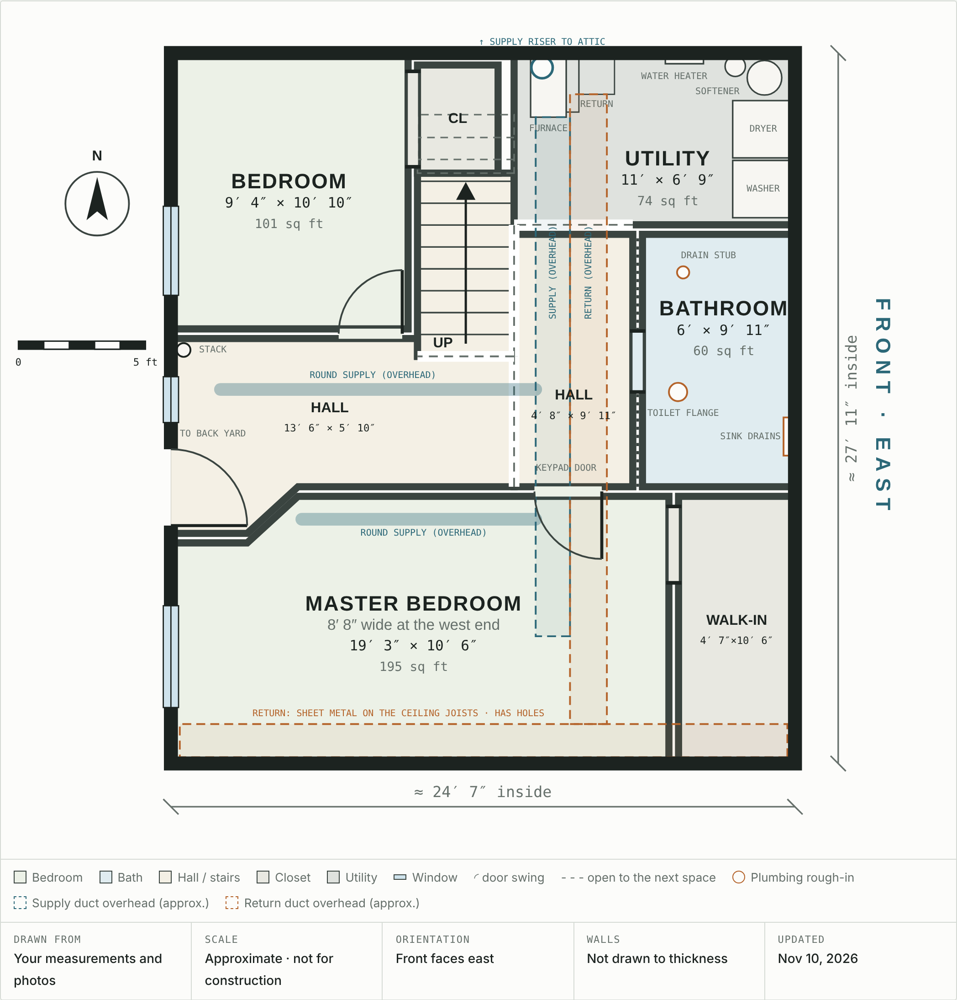

# Basement Plan

The basement as it is today, before renovation. It's drawn from the room measurements and photos taken November 9–10, 2026, and from where you said each room sits.

**Open `index.html` in a browser** to see the interactive version. Hovering a room highlights it in both the drawing and the room schedule.

## Overview

- **Orientation:** the front of the house faces east, the same as the [main floor plan](../). The basement sits under the main block (front room, kitchen, bath and bedrooms), not under the garage or the dining room.
- **Size:** about 616 sq ft of rooms and halls, about 24′ 7″ × 27′ 11″ inside.
- **Layout:**
  - **South:** the master bedroom and its walk-in closet span the whole south wall, under the two upstairs bedrooms.
  - **Northwest:** the smaller bedroom, under the kitchen, with its closet tucked under the stairs.
  - **Northeast:** the roughed-in bathroom against the front wall, and the open utility and laundry area north of it, both under the front room.
  - **Middle:** a hall beside the bathroom and a long hall along the master's north side. The long hall ends at a door to the back yard on the west wall.
- **Stairs:** they come down facing south under the main stair, landing where the two halls meet.

## What's drawn

- **Doors:** the master bedroom's keypad door, the bedroom door, and the door to the back yard.
- **Openings:** the walk-in closet and the bedroom closet (no doors); the bathroom's rough opening, since its walls are still open framing.
- **Windows:** three on the west wall, one each for the master bedroom, the long hall and the bedroom.
- **Plumbing rough-in:** the bathroom's sink drains, toilet flange and drain stub, and the main stack under the upstairs bathroom.
- **Utility:** the furnace, filter and return, the wall-hung water heater and the softener along the north wall; the washer and dryer on the east wall.
- **Heating ducts overhead** (approximate, from the photos): the supply riser straight up from the furnace to the attic; the supply and return runs side by side south over the hall into the master; round supply branches west along the long hall and through the master; and the returns made of sheet metal on the ceiling joists along the south wall, which have holes somewhere.
- **Open to the next space** (dashed): the utility area, the two halls, and the open side of the stairs.

The room sizes are your measurements. The doors, windows, rough-in and equipment are placed from the photos, so their positions are approximate.

## Room schedule

Sizes are east–west × north–south.

| Room | Size | Sq ft |
|---|---|---:|
| Master bedroom (8′ 8″ wide for 3 ft at the west end, angled back over 2 ft) | 19′ 3″ × 10′ 6″ | 195 |
| Master walk-in closet | 4′ 7″ × 10′ 6″ | 48 |
| Bedroom | 9′ 4″ × 10′ 10″ | 101 |
| Bedroom closet, under the stairs | 3′ 2″ × 4′ 3″ | 13 |
| Bathroom, roughed in | 6′ × 9′ 11″ | 60 |
| Utility area, open to the hall | 11′ × 6′ 9″ | 74 |
| Hall beside the bathroom | 4′ 8″ × 9′ 11″ | 46 |
| Long hall to the back door | 13′ 6″ × 5′ 10″ | 79 |
| **Basement, rooms and halls** | | **≈ 616** |

## Things to check

- **Asbestos test:** the old dark square floor tiles in the walk-in closet and the black adhesive in the bedrooms can contain asbestos. Have a sample of each tested before any more steaming or scraping.
- **Climb-out windows:** measure the opening and sill height of the bedroom and master windows. A basement bedroom needs a window big enough and low enough to climb out of. The bedroom's window opens under the deck.
- **The flue upstairs:** the furnace and water heater vent through plastic pipe. If nothing else uses the metal flue in the chase beside bedroom 2, the chase can come out rather than be boxed in.
- **What lines up:** front to back, master 10′ 6″ + bathroom 9′ 11″ + utility 6′ 9″ = 27′ 2″ on the front side, and master 10′ 6″ + long hall 5′ 10″ + bedroom 10′ 10″ = 27′ 2″ on the back side.

The basement photos are 19–33 in [`photos/`](../../photos/), and the room notes are in §4.10 of the [existing conditions](../../existing-conditions.md).
