# Photos: Existing Conditions

These photos show the main floor and the outside as they were on **November 8, 2026**, before renovation. The front of the house faces **east**. "Left" and "right" are as seen from the camera.

The full room-by-room notes are in [`../existing-conditions.md`](../existing-conditions.md), and the floor plan is in [`../floor-plan/`](../floor-plan/).

> Privacy: this repository is public, so the house number in photo 16 and the people in photo 17 are blurred.

---

## Front room (entry / living)

### 01 · Front room from the southwest corner
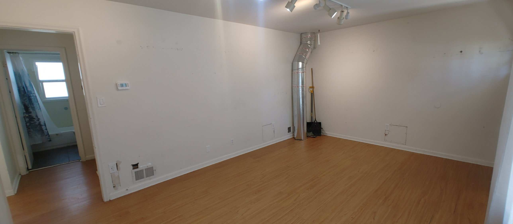

**Camera:** at the southwest corner of the front room, by the hall opening, looking north along the stair-side (west) wall.

- **Left:** a cased doorway to the hall. You can see straight across the hall into the bathroom's tub and window.
- **West wall:** solid, with the thermostat, a light switch, a floor register with damaged drywall around it, outlets, and a small cover plate low on the wall. The cover plate is probably from a removed baseboard heater.
- **Northwest corner:** an exposed round galvanized duct runs from the floor to the ceiling, right next to the stair landing.
- **North (garage) wall:** plain, with a cover plate low down.
- **Ceiling and floor:** track lighting on the ceiling and honey-toned laminate on the floor, in fair condition.

### 02 · Front room from the hall
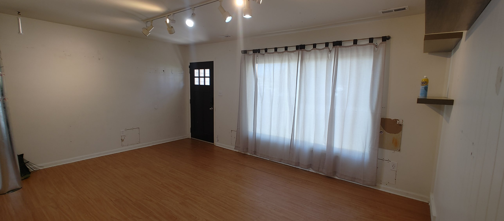

**Camera:** in the hall doorway, looking east toward the front of the house.

- **Front door:** at the north (left) end of the front wall, next to the garage. It's a black exterior door with a six-pane window.
- **Picture window:** in the middle of the front wall, about 7 ft wide, behind sheer tab-top curtains.
- **North wall:** a cover plate low down. The exposed duct is at the left edge.
- **South end of the front wall:** a damaged drywall patch below a floating shelf, and an outlet.
- **Ceiling:** track lighting and supply registers near the front wall.

---

## Hall, linen closet and pantry

### 03 · Hall looking south
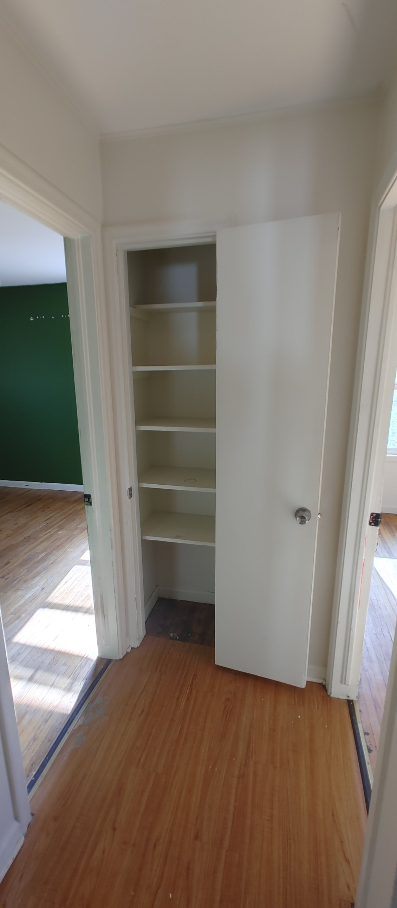

**Camera:** in the main hall, looking south to its dead end.

- **Straight ahead:** the linen closet. It's about 2 ft wide, with five fixed shelves and a flat slab door.
- **Left:** the green room door. Through it you can see the dark green walls and oak floor.
- **Right:** the bedroom 2 door. The two bedroom doors face each other.
- **Floor:** honey laminate, with metal transition strips at both bedroom doors.

### 04 · Hall looking north
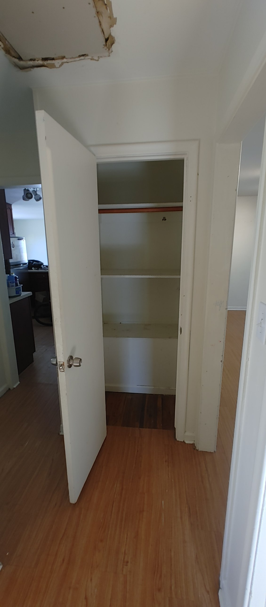

**Camera:** at the south end of the hall, looking north.

- **Straight ahead:** the pantry, a closet with a hanging rod over shelves, with its slab door open.
- **Down the left:** the short hall section leading into the kitchen. The kitchen counter and track light are visible.
- **Down the right:** the opening into the front room.
- **Ceiling:** a hole has been cut in the hall ceiling (top left), with torn drywall edges. The cause is unknown; check for a leak.

---

## Green room (bedroom)

### 05 · Green room from the southwest corner
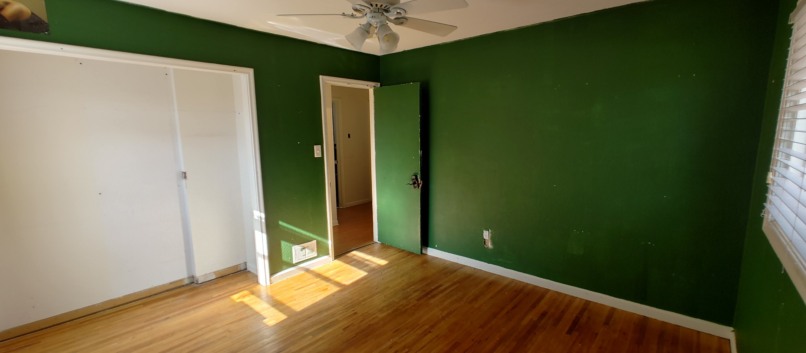

**Camera:** near the closet, looking north and northeast.

- **Left (west) wall:** a wide reach-in closet with two white bypass sliding doors. Further along the same wall are a floor register, a light switch and the hall door, a slab door painted green.
- **Walls:** dark green throughout.
- **Ceiling:** a ceiling fan with a light kit.
- **Floor:** oak strip hardwood in good condition. It needs refinishing.
- **Right edge:** a window with wood blinds.

### 06 · Green room from the door
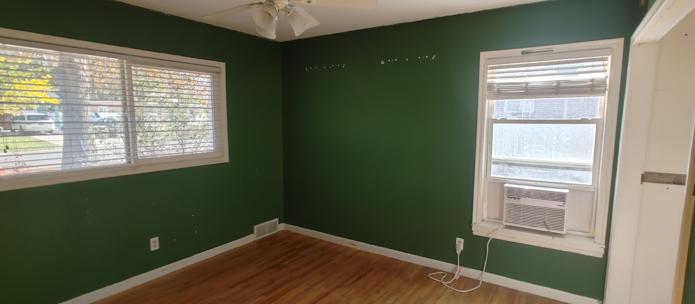

**Camera:** in the hall doorway, looking southeast.

- **Left (east / front) wall:** a two-panel horizontal sliding window with white blinds, facing the street.
- **Right (south) wall:** a double-hung window with blinds and a window air conditioner in the lower sash.
- **Corner between the windows:** a floor register.
- **North wall:** a row of anchor holes. It has no openings, so it's the natural spot for a bed.

---

## Bedroom 2

### 07 · Bedroom 2 from the southwest corner
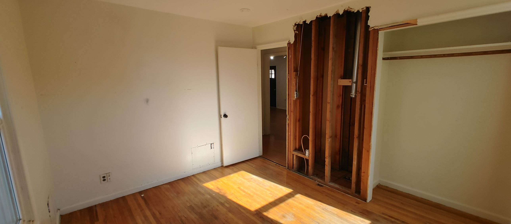

**Camera:** in the southwest corner, looking northeast.

- **Far (north) wall:** shared with the bathroom. It has a small access panel near the floor, probably for the tub plumbing.
- **East wall, north end:** a white flat slab door, open into the hall.
- **East wall, middle:** the drywall is removed. The opening shows studs, wiring, an outlet box and a **vertical metal flue pipe**, probably venting a gas appliance in the basement.
- **East wall, south end:** the closet. It's an open reach-in with a rod and shelf and no doors.
- **Floor:** oak strip hardwood, worn.
- **Left edge:** a window on the west wall.

### 08 · Bedroom 2 from the door
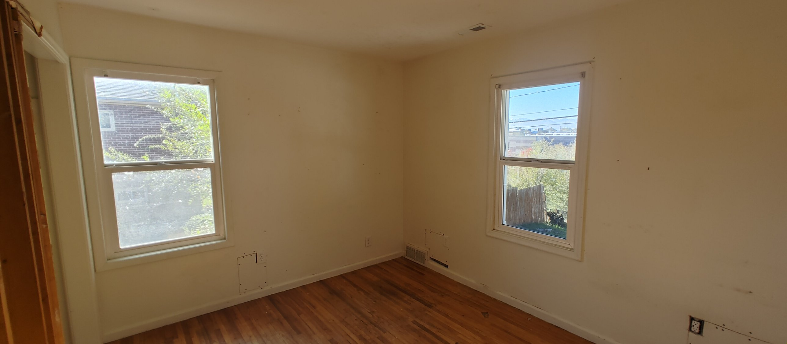

**Camera:** in the doorway, looking southwest.

- **Windows:** a white double-hung window on the south wall (left), toward the east end, and another on the west wall (right), near the southwest corner.
- **Southwest corner:** a floor register.
- **Ceiling:** a supply register.
- **Low on both outside walls:** cover plates or junction boxes, probably from removed baseboard heaters.
- **Bottom right:** an outlet with a drywall patch.
- **Walls:** many nail and anchor holes.
- **Left edge:** the edge of the opened-up wall.

---

## Bathroom

### 09 · Bathroom from the door
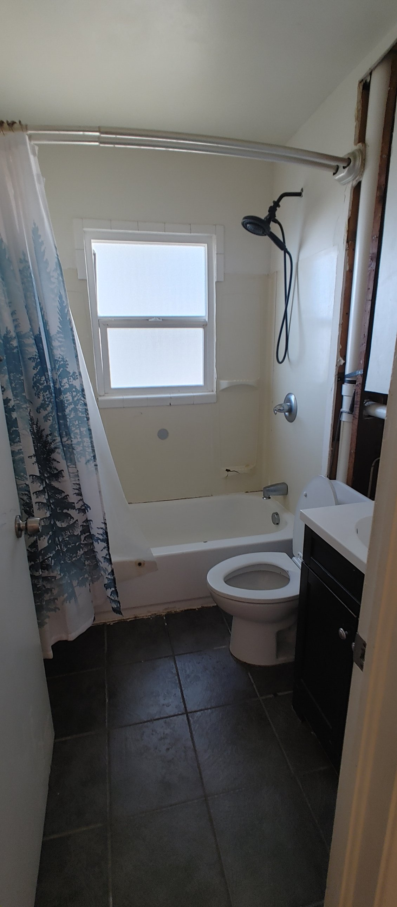

**Camera:** in the doorway on the east wall, looking west.

- **Tub:** a 5 ft tub and shower across the far (west) wall. The surround is plastic or fiberglass panels, **damaged**: there are holes, a missing section below the window, and failed caulk along the tub.
- **Window:** frosted double-hung, inside the shower, above the tub, with tile trim around it.
- **Shower fittings:** a curved shower rod, a black handheld shower head, and a chrome valve and spout.
- **Right (north) wall:** the toilet next to the tub, and a small espresso vanity with a white top by the door.
- **Floor:** large dark gray tile.
- **Wall by the door (right):** opened up, showing the white PVC drain and vent pipe.
- **Exhaust fan:** none visible.

---

## Kitchen

### 10 · Kitchen from the hall
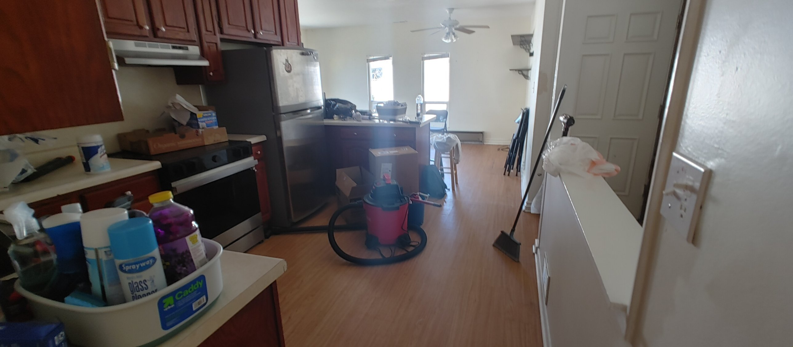

**Camera:** at the hall opening (the kitchen's southeast corner), looking north through the kitchen to the dining room.

- **Left (south and west walls):** laminate counter, a stainless electric range with a white under-cabinet hood, cherry-stained raised-panel upper cabinets, and a stainless top-freezer fridge at the north end of the run.
- **Middle:** the breakfast-bar peninsula with a wood base, laminate top and stools.
- **Right:** the stair half wall with a white cap. Beyond it is the six-panel door to the garage at the landing.
- **Beyond:** the dining room's two north windows and ceiling fan.
- **Floor:** honey laminate.

### 11 · Kitchen from the southwest corner
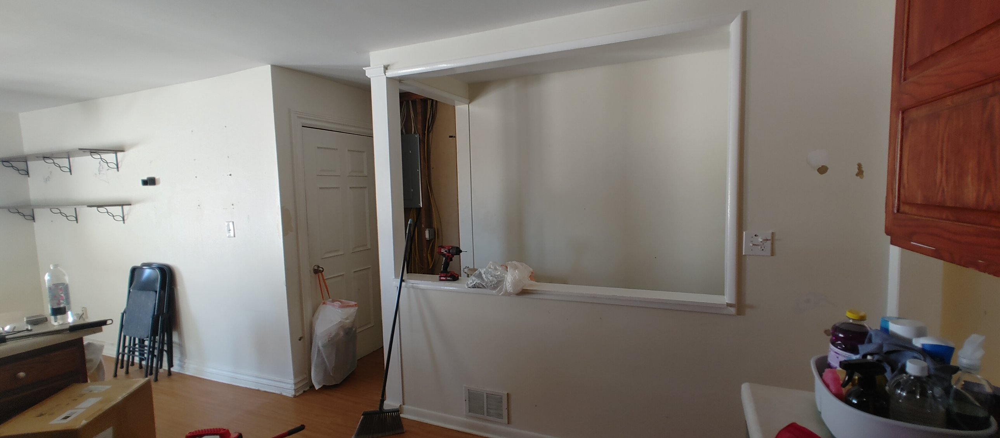

**Camera:** in the kitchen's southwest corner, looking northeast at the stair side.

- **Right side (east wall):** the stairwell's kitchen side. It's a half wall with a large framed pass-through above it, with a white header and trim, and a white post at the landing end. There's a floor register in the half wall.
- **Through the pass-through:** the solid stairwell wall on the front room side, and an **open wall bay with the electrical panel** and exposed wiring at the top of the stairs.
- **Left of the post:** the landing, with the six-panel door to the garage.
- **Left:** the dining room's east (garage) wall, with decorative shelves, a light switch and folding chairs.
- **Right edge:** the south wall's upper cabinets and counter.

### 18 · Kitchen from the dining room
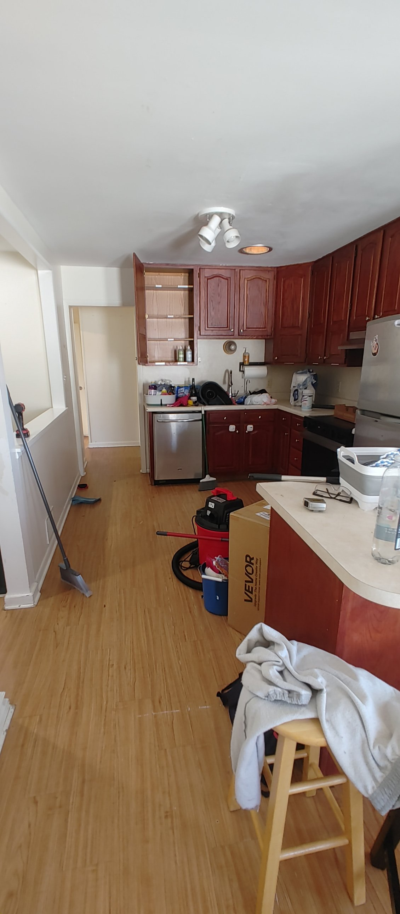

**Camera:** at the peninsula on the dining side, looking south into the kitchen.

- **South wall:** the **sink** (single bowl, gooseneck faucet, no window) under the cherry upper cabinets, with a **stainless dishwasher** to its left at the east end of the run, beside the hall opening.
- **Right (west wall):** the base cabinets run around the corner to the range and the fridge.
- **Ceiling:** a 3-head track light and one recessed can light.
- **Left:** the stair half wall and pass-through, and the short hall opening at the kitchen's southeast corner.
- **Right foreground:** the peninsula (cherry base, laminate top with a rounded end) and a stool.

---

## Dining room

### 12 · Dining room from the kitchen, by the stairs
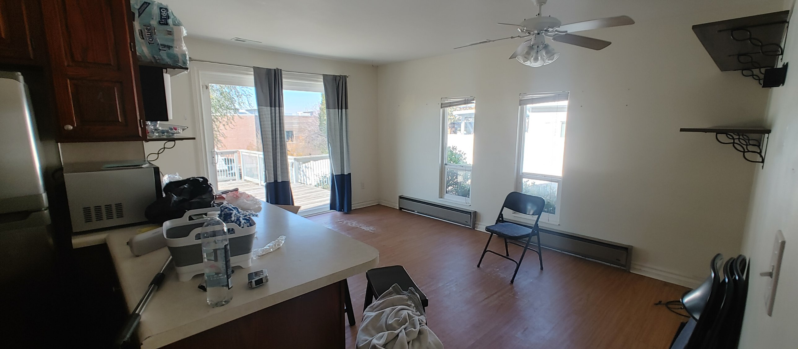

**Camera:** where the kitchen meets the dining room, near the top of the stairs, looking northwest.

- **Left foreground:** the fridge, upper cabinets, a countertop microwave, and the peninsula top with its rounded end.
- **Far (west / back) wall of the bump-out:** a vinyl sliding patio door to the deck, with blue and gray curtain panels. There's a ceiling supply register above it.
- **Right (north) wall:** two double-hung windows with mini blinds, each with an **old electric baseboard heater** below it.
- **Ceiling:** a fan with a light kit.
- **Both side walls:** decorative shelves.
- **Floor:** laminate, worn in front of the slider.

### 13 · Dining room from the northwest corner
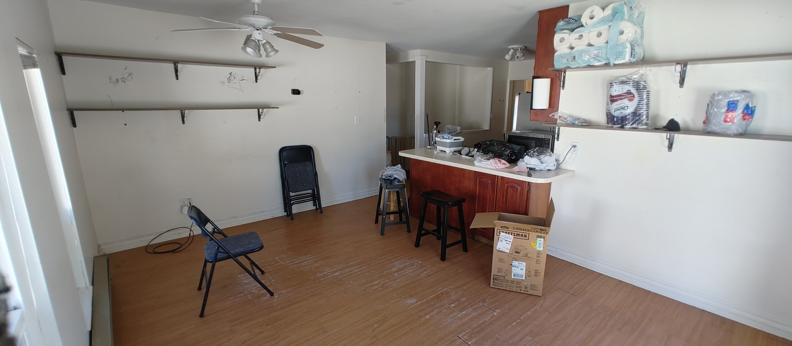

**Camera:** in the northwest corner (by the slider), looking southeast toward the kitchen.

- **Left:** the edge of a north window, with a baseboard heater below.
- **Far (east / garage) wall:** two long wall shelves, the thermostat or a control box, a light switch and an outlet.
- **Center:** the peninsula with a cherry base and laminate top, with stools on the dining side. Behind it are the fridge and microwave, the white post, the stair pass-through, and the gate at the top of the stairs.
- **Right wall:** shelves with paper goods and a paper towel holder, then the wood upper cabinets where the kitchen starts.
- **Lights:** a ceiling fan with a light kit in the dining room, and track lights in the kitchen.
- **Walls and floor:** marker, anchor holes and scuffs on the walls. The floor is worn through along the walking path.

---

## Garage

### 14 · Garage from the house door
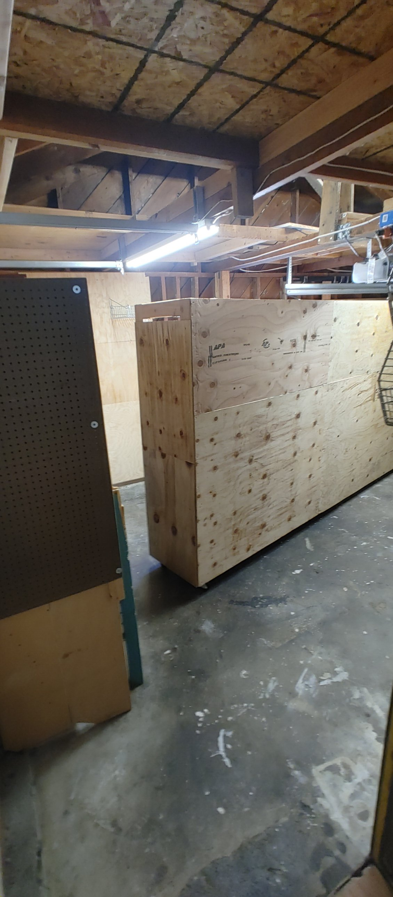

**Camera:** in the doorway from the stair landing, looking toward the front.

- **Ceiling:** open to the roof framing (rafters with board sheathing), with a partial OSB storage loft on the ceiling joists.
- **Garage door:** the opener rail and opener are visible, with an LED shop light.
- **Wiring:** exposed cable stapled along the joists.
- **Walls:** plywood.
- **Contents:** a large rolling plywood storage cabinet and pegboard.
- **Floor:** stained concrete.

### 15 · Garage from the driveway
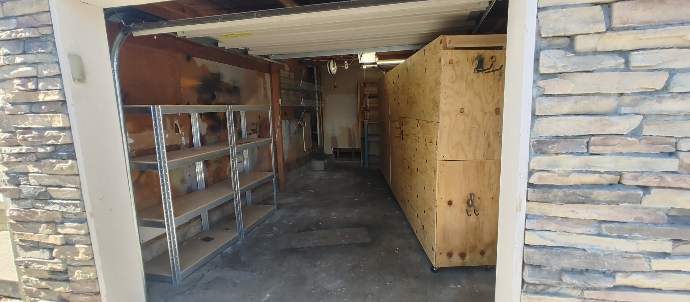

**Camera:** outside, looking in through the open garage door.

- **Around the opening:** stacked stone veneer, with cream trim and a small wall light on the left.
- **Garage door:** a white steel sectional door, rolled up, with an opener.
- **Left (south) wall:** metal shelving. The plywood high on this wall has **dark stains**: soot, mold or old paint, still to be identified.
- **Right:** the rolling plywood cabinet.
- **At the back:** wooden steps up to the landing door.

---

## Exterior

### 16 · Front of the house
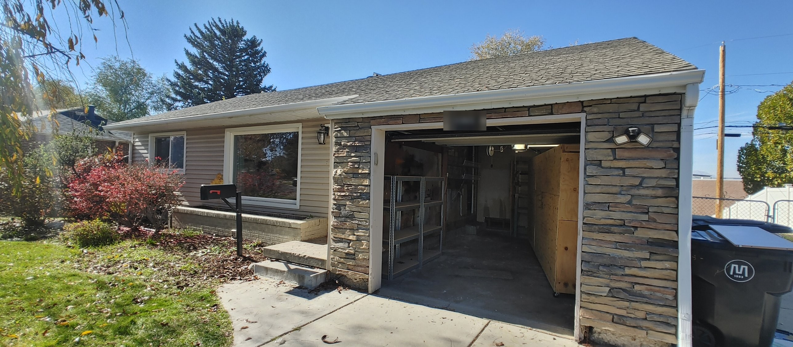

**Camera:** in the front yard at the southeast, looking northwest. The house number is blurred.

- **Siding and stone:** beige vinyl lap siding on the house, with stacked stone veneer on the front of the projecting garage.
- **Roof and trim:** white fascia, gutters and downspouts, with vented soffits. The roof is gray architectural asphalt shingles, with the ridge parallel to the street.
- **Windows (left to right):** the green room's front slider, then the front room's large picture window.
- **Lights:** a black lantern beside the picture window, and an LED flood light on the garage front.
- **Entry:** a concrete stoop with two steps in the corner beside the garage. The front door is hidden behind the garage's side wall.
- **Planter:** a raised, painted brick planter along the front of the house.
- **Yard:** lawn, red burning bushes, a mailbox on a post, the concrete driveway and walk, and a utility pole on the north side.

### 17 · Back of the house and the deck
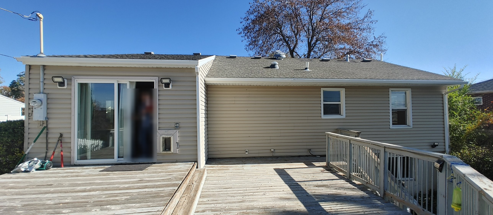

**Camera:** on the deck, looking east at the back of the house. The people are blurred.

- **Left:** the dining room bump-out. It has the sliding patio door, a pet door beside it, two LED flood lights, and the **electric meter and service mast** at its north end. It has its own low roof tying into the main roof.
- **Right:** the main back wall, in beige vinyl. There's a long blank stretch behind the kitchen, then the **bathroom window**, then **bedroom 2's west window**, plus an LED flood light near the south end.
- **Roof:** several box vents, a turbine vent and plumbing vent pipes. The south end appears to be **hipped**.
- **Deck:** large, with weathered gray boards in two sections (in front of the slider, and along the back wall). The white railing has peeling paint, with steps at the south end.
- **Under the deck:** a **basement window**, at the south end.
