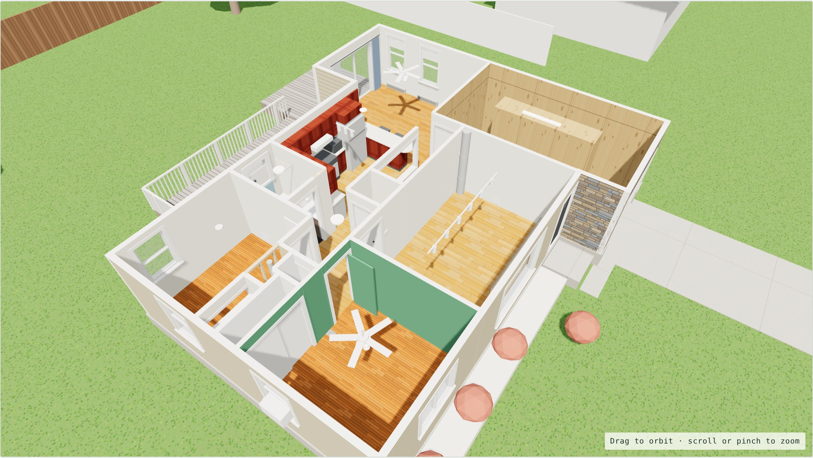
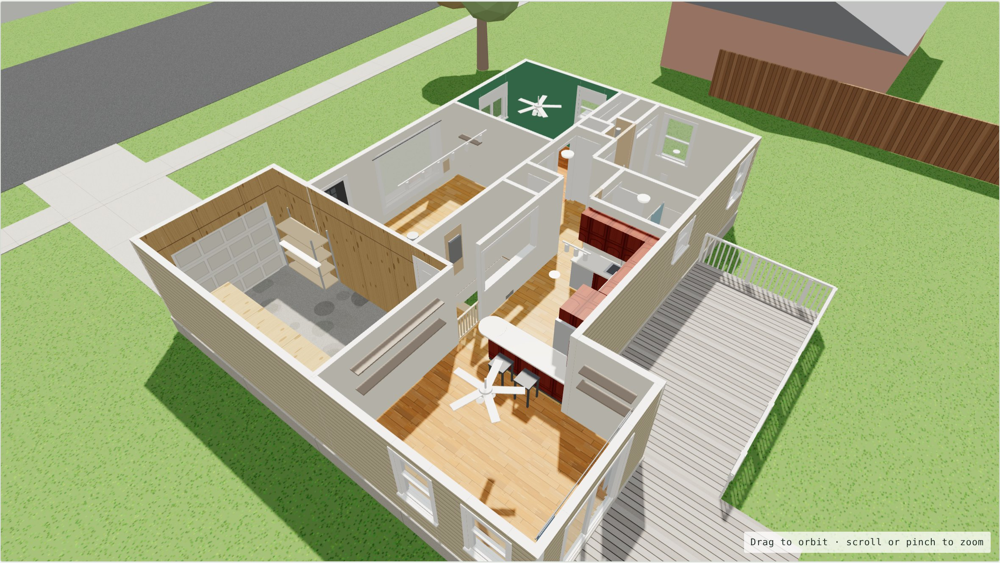
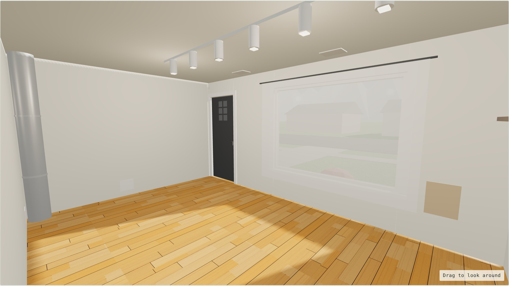
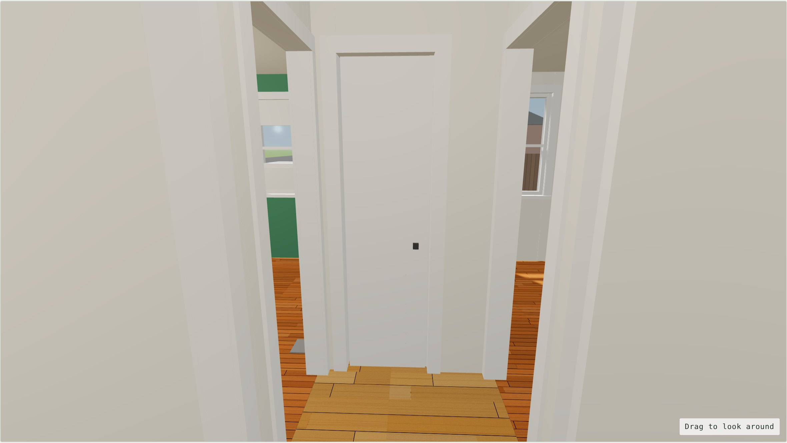
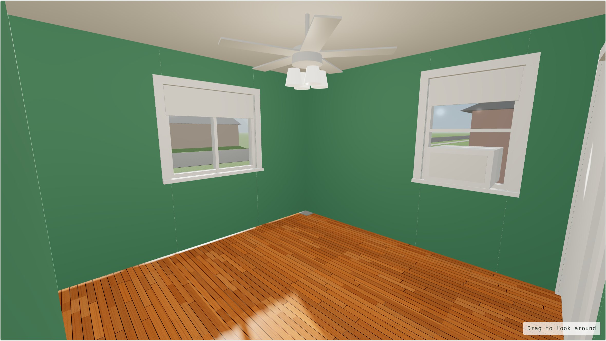
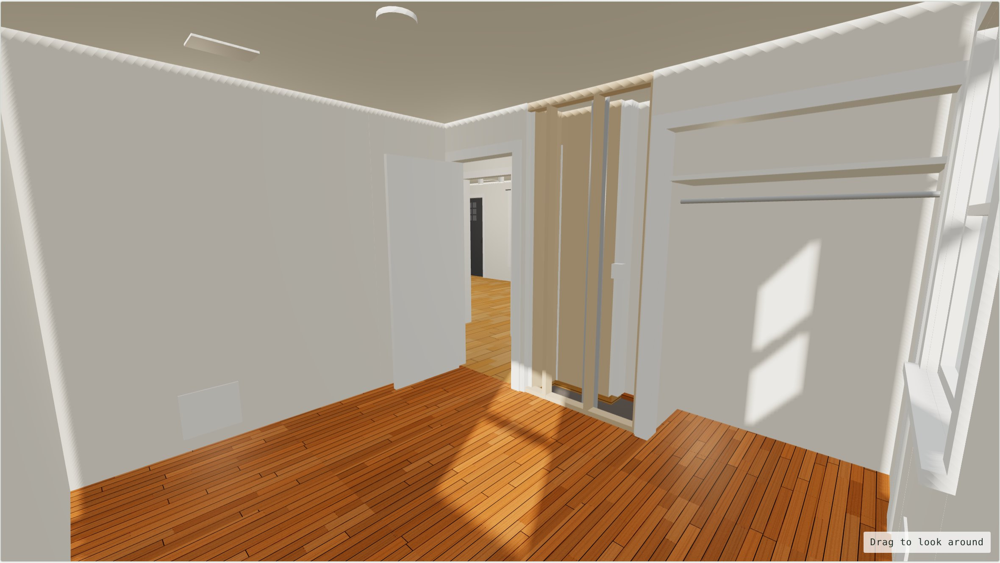
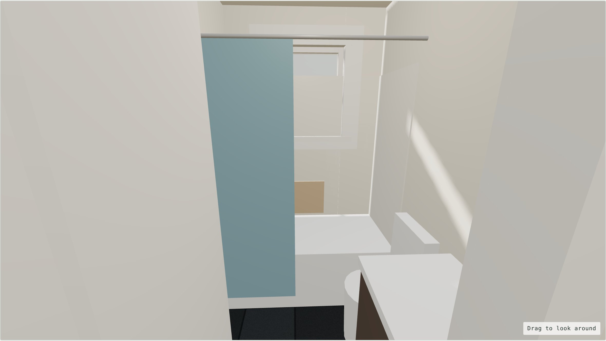
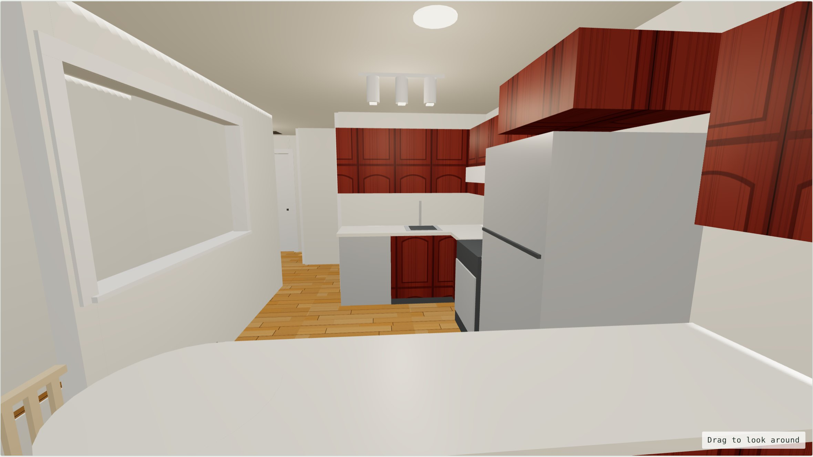
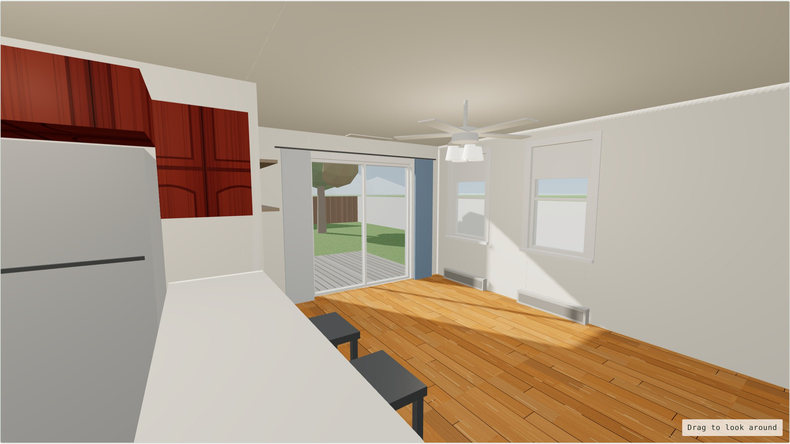

# Baseline: the house as it is today (November 8, 2026)

This is the **starting-point 3D model** of the main floor, before any renovation. Every later version of the model will be compared against this one, so **don't edit this folder**. Make changes in a new, dated folder instead (see [`../README.md`](../README.md)).

It's built from the measured [floor plan](../../floor-plan/), the [walkthrough photos](../../photos/) and the notes in [`existing-conditions.md`](../../existing-conditions.md).

## How to view it

- **Quick look:** the snapshot images below.
- **Interactive model:** download `index.html` and open it in a web browser. It needs an internet connection to load the 3D library. In a cutaway view, drag to orbit and scroll to zoom. In a room view, drag to look around.

## Snapshots

| View | Compare with photo |
|---|---|
|  **Cutaway from the front.** Ceilings off, front (east) at the bottom left. | — |
|  **Cutaway from the back.** The dining bump-out, kitchen and stairs. | — |
|  **Front room** from the hall doorway. | [02](../../photos/02-front-room-from-hall.jpg) |
|  **Hall** looking south to the linen closet. | [03](../../photos/03-hall-looking-south.jpg) |
|  **Green room** from the door. | [06](../../photos/06-green-room-from-door.jpg) |
|  **Bedroom 2** from the southwest corner. | [07](../../photos/07-bedroom-2-from-sw-corner.jpg) |
|  **Bathroom** from the hall. | [09](../../photos/09-bathroom-from-door.jpg) |
|  **Kitchen** from the dining side of the breakfast bar. | [18](../../photos/18-kitchen-from-dining.jpg) |
|  **Dining room** from the top of the stairs. | [12](../../photos/12-dining-from-kitchen-by-stairs.jpg) |

## What this model shows

**Layout**

- Every room is at its measured size.
- Doors, windows, closets and openings are placed where the photos show them.
- The two bedroom doors face each other at the south end of the hall, with the linen closet between them. The flue chase is beside the linen closet.
- The front door is at the north end of the front wall, next to the garage, which sticks out 4′ 3″.
- The kitchen is a U, with the sink and dishwasher on the south wall, the range and fridge on the back wall, and the breakfast bar on the dining side.
- The stairwell is half-open to the kitchen (half wall and pass-through) and solid on the front room side.
- The dining room's slider is on the bump-out, and its two windows are on the north wall.

**Finishes**

- Floors: honey laminate in the living areas, worn in the dining room; oak strip in both bedrooms; dark tile in the bath.
- Walls: cream throughout, dark green in the green room.
- Kitchen: cherry raised-panel cabinets with almond laminate counters.

**Fixtures**

- Ceiling fans with light kits in the dining room and green room, and track lights in the front room and kitchen.
- The window AC in the green room, and the two baseboard heaters in the dining room.
- The live round duct in the front room's northwest corner.

**Existing problems, shown as they are**

- Bedroom 2's open wall, with the studs and flue pipe.
- The open wall by the bathroom door, with the drain pipe.
- The damaged tub surround.
- The open electrical panel bay at the top of the stairs.
- The hole in the hall ceiling.

## Approximations

- **Estimated, not measured:** window sizes and the linen closet. The deck size is a guess.
- **Exterior:** a simple shell with beige siding, the stone garage front and the brick planter. The roof is left off.
- **Walls** aren't drawn to their real thickness.
- **The 2D floor plan in [`floor-plan/`](../../floor-plan/) hasn't caught up yet.** It doesn't have the corrections from the photos (listed in `existing-conditions.md`, section 8). This 3D model does.
