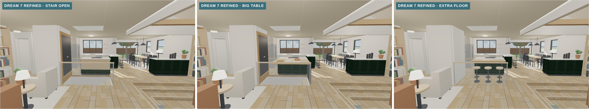
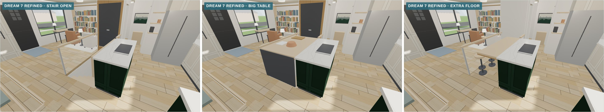
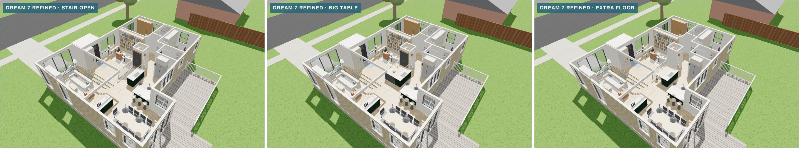
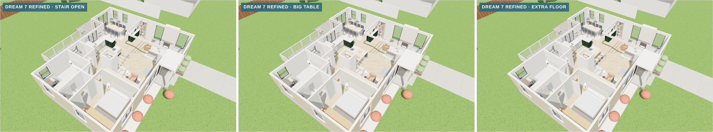
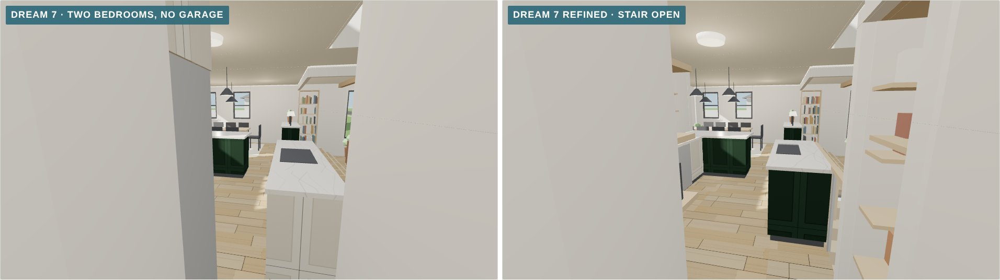
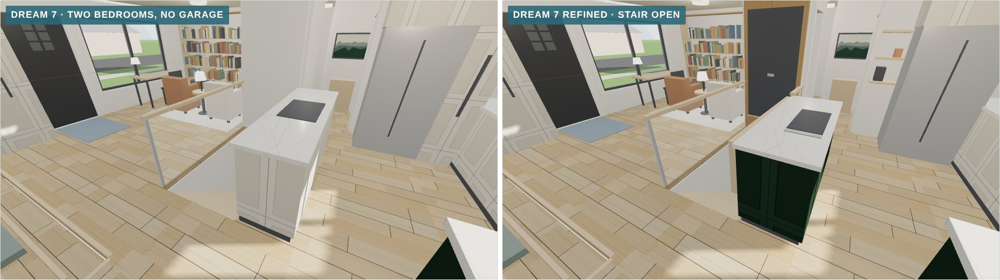
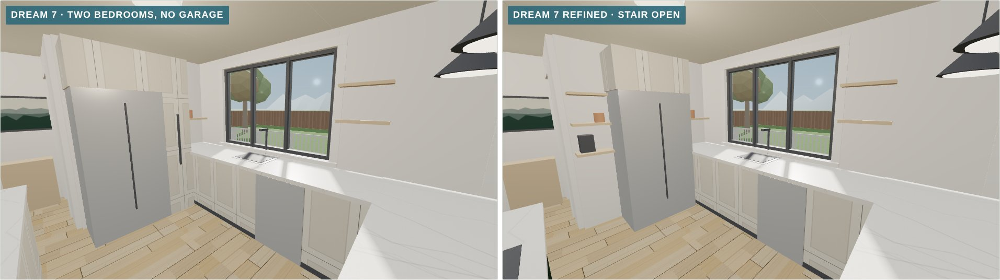
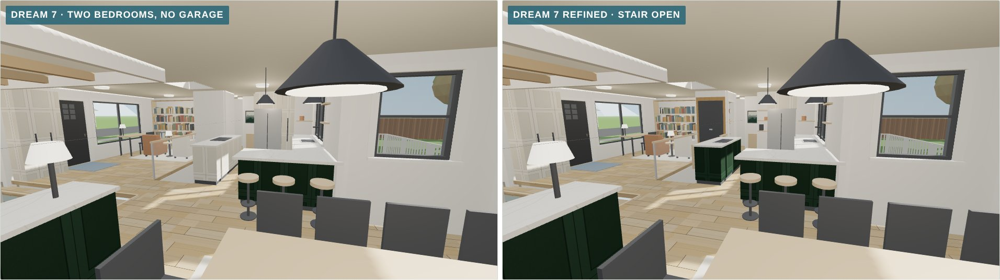

# Dream 7 refined in 3D (November 8, 2026)

This is a 3D model of [concept 13](../../concepts/2026-11-08-layout-concepts/#13--dream-7-refined), a refined version of [Dream 7](../2026-11-08-dream-plans-6-and-7/).

- **A clear way in from the bedroom hall.** The island is shorter and starts about 4 ft from the hall instead of 2, and the fridge moves a step west. In Dream 7 you had to jog around the corner of the cooktop counter, right beside the fridge.
- **The pantry is back.** The old pantry is a pantry again, open to the kitchen, with shelves on three sides. The laundry goes in the basement.
- **A stairwell with three settings:**
  - **Stair:** most days it's a stair, with the table leaf folded on the island's stair side and the floor panel standing upright at the bottom end.
  - **Big table:** the leaf unfolds across the stairwell onto the library-side rail, making about 31 sq ft of work surface with the island. A gate closes the top of the stair.
  - **Extra floor:** the floor panel folds down flush with the floor, adding about 26 sq ft, and half the leaf becomes a bar ledge for three stools.

Everything else is the same as Dream 7. It's built in the same scene as today and Dreams 1 to 7.

*The three settings from just inside the front door: stair, big table, extra floor.*

## How to view it

- **Quick look:** the images below.
- **Interactive model:** download `index.html` and open it in a web browser. It needs an internet connection to load the 3D library.
  - Pick **Dream 7 refined** in the switch at the top, then use the **Stairwell** buttons under it to change the setting.
  - Two views are new for this version: **Out of the bedroom hall** and **The stair and the island**.

## The three settings

| View | Stair · Big table · Extra floor |
|---|---|
| **Just inside the front door** |  |
| **The stair and the island** |  |
| **Cutaway from the back** |  |
| **Cutaway from the front** |  |

## Dream 7 and Dream 7 refined

| View | Dream 7 · Dream 7 refined |
|---|---|
| **Out of the bedroom hall** |  |
| **The stair and the island** |  |
| **The old kitchen's west wall** |  |
| **Back toward the middle** |  |

Each Dream 7 refined view is also saved on its own, for example `dream-7-refined-out-of-the-bedroom-hall.jpg`, and `dream-7-refined-table-` or `dream-7-refined-floor-` for the other settings.

## Approximations

- **The moving panels are drawn simply.** The hinges, counterbalance and brackets would be designed by whoever builds them.
- **Finishes are placeholders**, the same as the other dream plans.
- **Not yet checked:** the inspector's view on closing the stair, the basement's egress windows, and everything listed for Dream 7.
- **The other models in this file** match their own folders. Two new views were added for every model: Out of the bedroom hall, and The stair and the island.
