# Dream plan 5 in 3D: fewer walls, no garage (November 8, 2026)

This is a 3D model of [concept 10](../../concepts/2026-11-08-layout-concepts/#10--fewer-walls-garage-converted). It takes Dream 3's approach of removing every wall that isn't needed, but the garage no longer has to be a garage. It becomes a sunken living room that opens straight onto the landing and the kitchen. The front room becomes a library you walk through from the front door.

It's built in the same scene as the [baseline](../2026-11-08-baseline/) and Dreams [1](../2026-11-08-dream-plan/), [2](../2026-11-08-dream-plan-garage-kept/), [3 and 4](../2026-11-08-dream-plans-3-and-4/), so all six can be compared from the same camera.

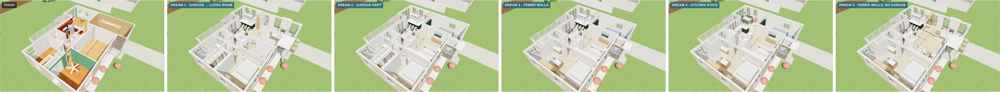
*From left: today, then Dreams 1 to 5, cutaway from the front.*

## How to view it

- **Quick look:** the three-way images below show today, Dream 3 and Dream 5 from the same spot.
- **Interactive model:** download `index.html` and open it in a web browser. It needs an internet connection to load the 3D library.
  - The switch at the top flips between **Today** and **Dreams 1 to 5**.
  - In a cutaway view, drag to orbit and scroll to zoom. In a room view, drag to look around.

## What changes

- **Living room in the old garage:**
  - It's three steps down, using the garage floor's existing drop.
  - It has a vaulted ceiling with oak beams.
  - A big window with a window seat replaces the garage door.
  - A fireplace sits between two windows on the north wall.
- **Wide steps:** the garage walls come out, and the old wall line becomes wide steps along the south and west sides of the room. A raised strip at house level runs from the landing to the kitchen, with built-in shelves at its north end.
- **Kitchen:** it sits by the deck, as in Dream 3. The fridge and pantry are a freestanding oak block where the garage wall was, and the kitchen opens to the living room beside it.
- **Library and entry:** the front room has books along the south wall, a desk at the picture window and two reading chairs. The front door stays in the notch under a covered porch, with a coat cabinet beside it. There's no entry addition.
- **The same as Dream 3:**
  - the open primary suite;
  - the open hall and the laundry cupboard;
  - the glass stair with a skylight;
  - dining in the old kitchen spot.
- **Walls:** about 73 ft of interior wall comes out, including the garage walls. Another 15 ft turns into glass at the stair, and about 12 ft of new wall goes in.

## Today, Dream 3 and Dream 5

| View | Today · Dream 3 · Dream 5 |
|---|---|
| **Cutaway from the front** | 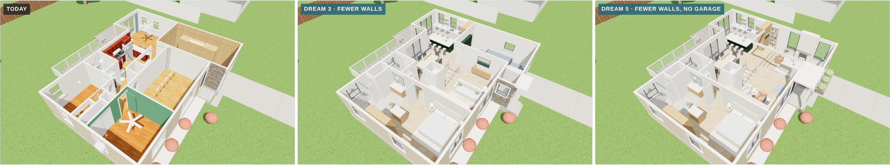 |
| **Cutaway from the back** | 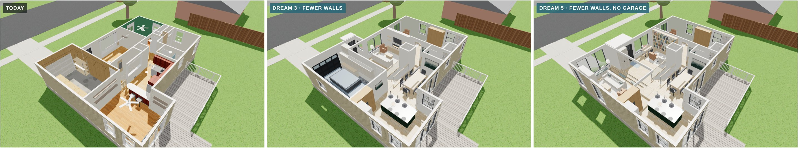 |
| **Just inside the front door** | 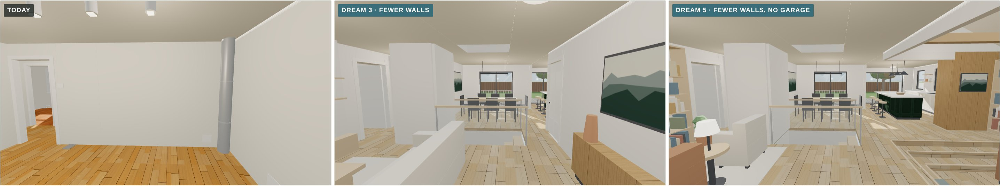 |
| **Front room** | 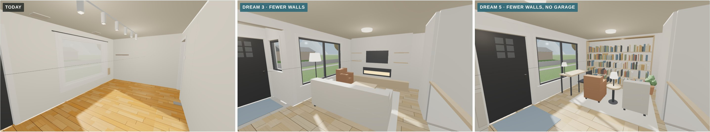 |
| **North from the front room** | 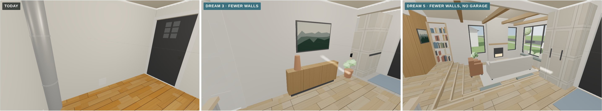 |
| **Garage end, looking out** | 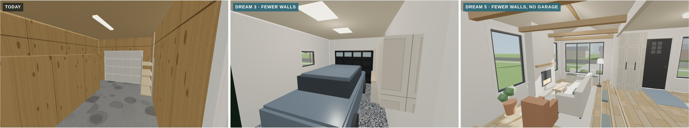 |
| **Garage end, looking in** | 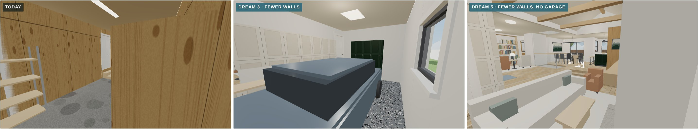 |
| **Toward the deck** | 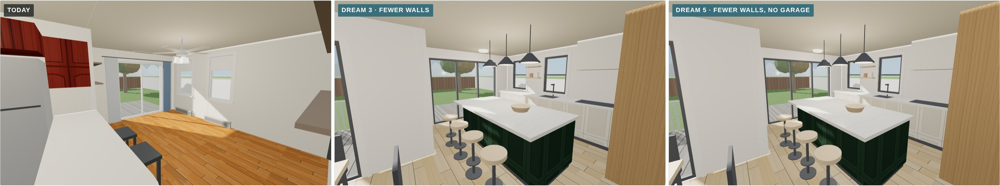 |
| **Back toward the middle** | 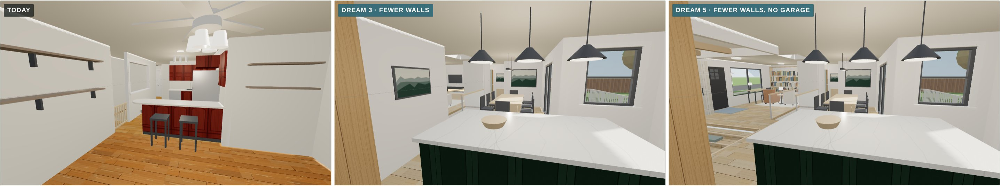 |
| **Primary suite, end to end** | 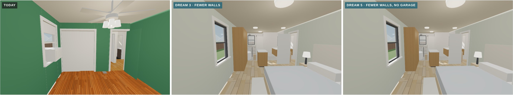 |

Each Dream 5 view is also saved on its own, for example `dream-5-north-from-the-front-room.jpg`.

## Approximations

- **Finishes are placeholders**, the same as the other dream plans.
- **Not yet checked:**
  - whether the city allows the garage to become living space without parking elsewhere;
  - the beams for the garage walls, the landing, the stair walls, the hall and the vaulted ceiling;
  - the exact drop from the house floor to the garage slab. The model uses three equal steps.
- **Unchanged:** the roof is left off, and the deck is the existing one.
- **The other models in this file** match their own folders. The "Just inside the front door" camera moved a little further into the front room for this version, so it doesn't sit inside Dream 5's coat cabinet.
