# Dream plan with the garage kept, in 3D (November 8, 2026)

This is a 3D model of [concept 7, the dream plan with the garage kept](../../concepts/2026-11-08-layout-concepts/#7--dream-plan-garage-kept). It's built in the same scene as the [baseline](../2026-11-08-baseline/) and the [first dream plan](../2026-11-08-dream-plan/), so all three can be compared from the same camera.

## How to view it

- **Quick look:** the side-by-side images below, with today on the left and this plan on the right.
- **Interactive model:** download `index.html` and open it in a web browser. It needs an internet connection to load the 3D library.
  - The switch at the top flips between **Today**, **Dream 1** (the garage becomes the living room) and **Dream 2** (the garage stays), from the same spot.
  - In a cutaway view, drag to orbit and scroll to zoom. In a room view, drag to look around.

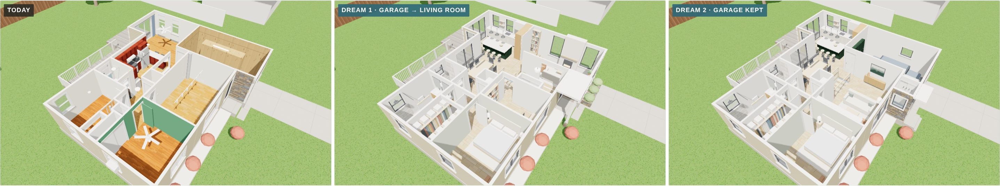
*Today, Dream 1 and Dream 2, cutaway from the front.*

## What's different from the baseline

- **Garage:** it stays a garage, finished. It gets:
  - insulation and drywall;
  - an epoxy floor;
  - a new insulated door with a row of windows;
  - storage cabinets and an EV charger;
  - green lockers with a bench by the steps up to the house.

  A car is shown for scale.
- **Entry addition:** a small addition fills the corner beside the garage, flush with its front. The front door faces the street, with a coat closet inside and a canopy and stoop outside.
- **Living room:** the front room stays the living room. It opens to the stair through glass, and has a media wall with a linear fireplace on the south wall.
- **Kitchen, dining, stair and primary suite:** the same as Dream 1.
  - The kitchen moves by the deck. Its tall fridge and pantry wall backs onto the garage and stops short of the island, so the aisle stays clear.
  - The dining room takes the old kitchen spot.
  - The stair sits behind glass under a skylight.
  - The two south bedrooms become a primary suite with a walk-in closet and a spa bath. The bedroom keeps its current wall line, so it's a foot shorter than in Dream 1.
- **Hall bath and laundry:** the hall bath gets a walk-in shower, and the old pantry becomes the laundry closet.

## Side by side: today (left) and Dream 2 (right)

| View | Comparison |
|---|---|
| **Cutaway from the front** | 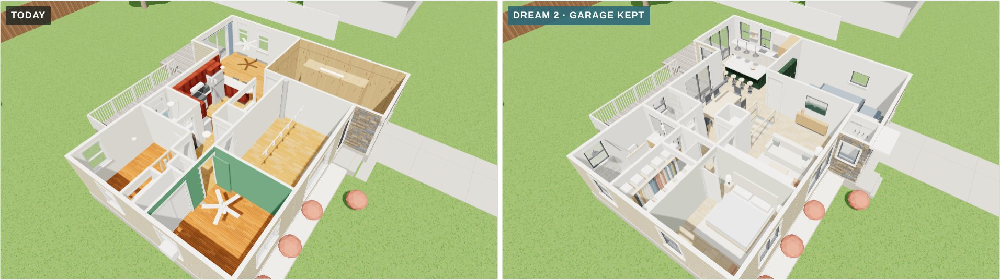 |
| **Cutaway from the back** | 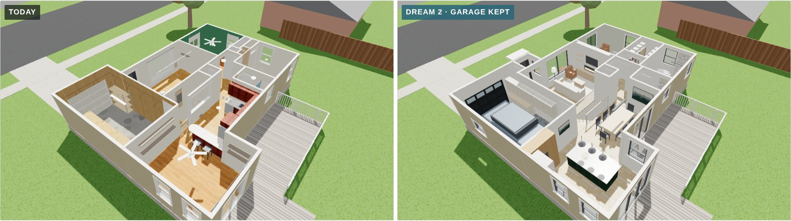 |
| **Just inside the front door** | 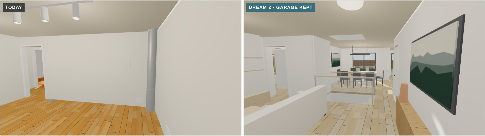 |
| **Front room** | 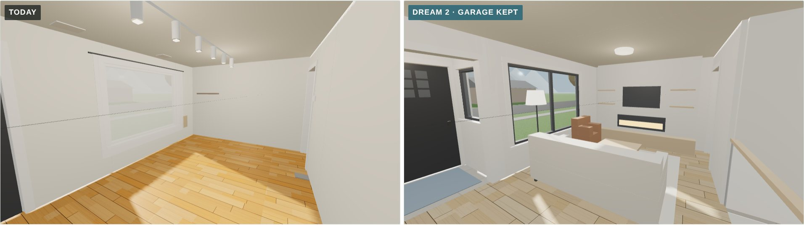 |
| **Garage, looking out** | 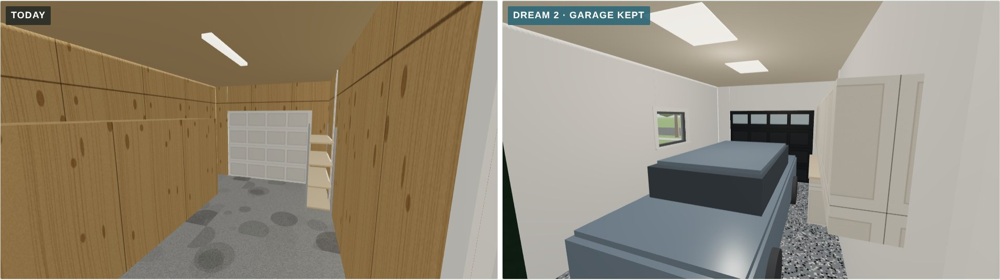 |
| **Garage, looking in** | 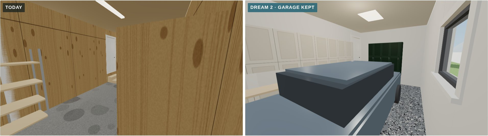 |
| **Toward the deck** | 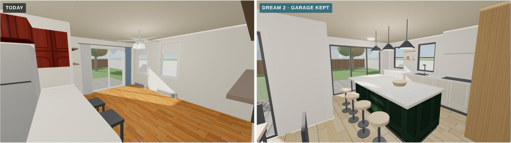 |
| **Back toward the middle** | 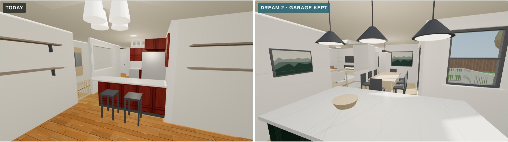 |
| **Green room → primary bedroom** | 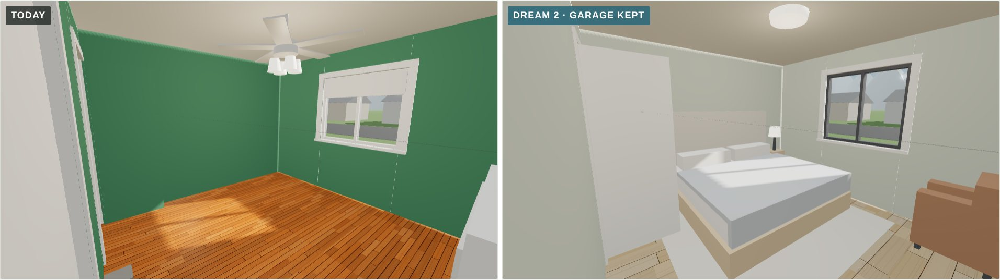 |
| **Bedroom 2 → spa bath** | 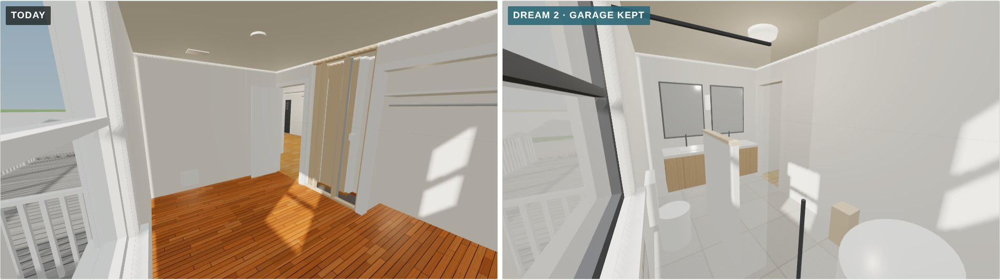 |

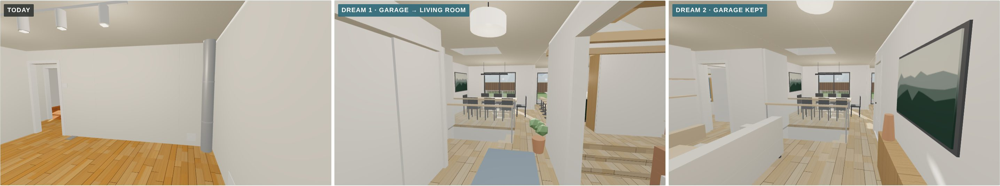
*Just inside the front door: today, Dream 1 and Dream 2.*

The Dream 2 views are also saved on their own, named after each view (for example `garage-looking-in.jpg`).

## Approximations

- **Finishes are placeholders** to show the feel, the same as Dream 1: white oak floors, warm white walls, quartz counters, black window frames, a soft green bedroom and a green island and lockers.
- **Not yet checked:**
  - the entry addition's setback;
  - the beams at the landing and stair walls.
- **Unchanged:** the roof is left off, and the deck is the existing one.
- **Other models in this file:** Today and Dream 1 are the same as in [`../2026-11-08-baseline/`](../2026-11-08-baseline/) and [`../2026-11-08-dream-plan/`](../2026-11-08-dream-plan/).
