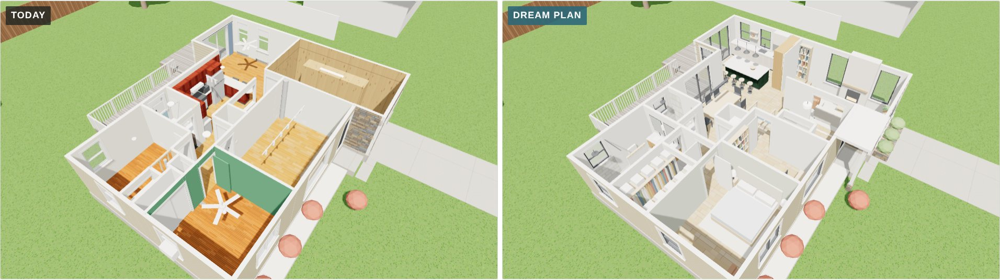
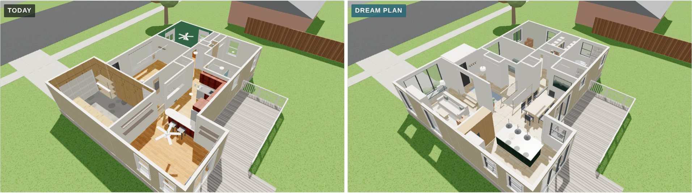
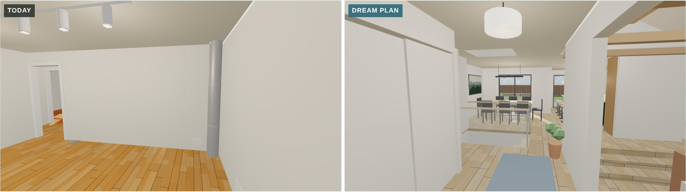
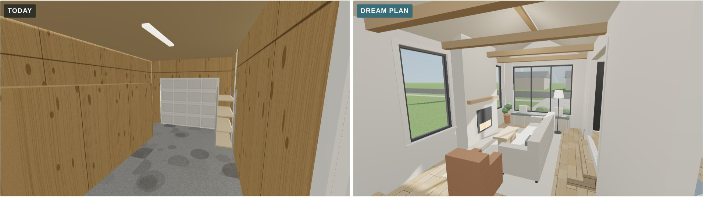
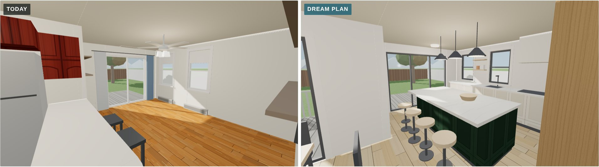
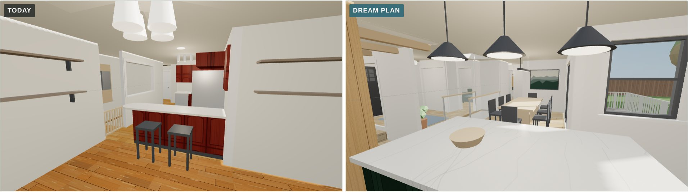
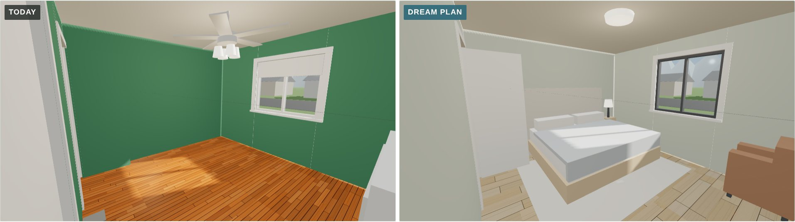
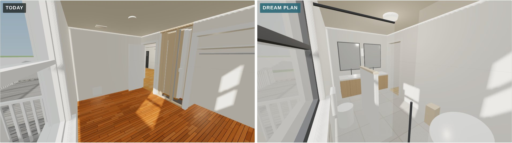

# Dream plan in 3D (November 8, 2026)

This is a 3D model of [concept 6, the dream plan](../../concepts/2026-11-08-layout-concepts/#6--dream-plan), built in the same scene as the [baseline](../2026-11-08-baseline/) so the two can be compared from the same camera.

## How to view it

- **Quick look:** the side-by-side images below, with today on the left and the dream plan on the right.
- **Interactive model:** download `index.html` and open it in a web browser. It needs an internet connection to load the 3D library.
  - Use the **Today / Dream plan** switch to flip between the two versions from the same spot.
  - In a cutaway view, drag to orbit and scroll to zoom. In a room view, drag to look around.

## What changed compared with the baseline

- **Garage → living room:** the garage becomes a sunken living room, three steps down. It uses the garage floor's existing 1½–2 ft drop and has:
  - a vaulted ceiling with oak beams;
  - a window seat where the garage door was;
  - a plaster fireplace on the north wall.
- **Kitchen:** it moves to the old dining room by the deck. It has a green island with four stools, counters under the north windows, a tall oak wall for the fridge, pantry and ovens, and a wide glass door to the deck.
- **Dining:** it takes the old kitchen spot, with new glass doors to the deck.
- **Stair:** it stays where it is, behind glass guards with oak rails, under a new skylight.
- **Front room:** it becomes a foyer with a bench, hooks and a coat closet, plus an office or guest room with the front window. A covered porch shelters the front door.
- **Primary suite:** the two south bedrooms become one suite.
  - The green room is the bedroom, painted a softer green.
  - A walk-in closet replaces the old closets and the flue chase.
  - Bedroom 2 becomes a spa bath with a freestanding tub, a walk-in shower, a double vanity and a low wall around the toilet.
- **Hall bath and laundry:** the hall bath gets a walk-in shower, and the old pantry becomes a laundry closet.

## Side by side

| View | Today (left) and the dream plan (right) |
|---|---|
| **Cutaway from the front** |  |
| **Cutaway from the back** |  |
| **From the front door** |  |
| **Garage → living room** |  |
| **Toward the deck** |  |
| **Back toward the middle** |  |
| **Green room → primary bedroom** |  |
| **Bedroom 2 → spa bath** |  |

The dream-plan views are also saved on their own: `cutaway-front.jpg`, `cutaway-back.jpg`, `front-door.jpg`, `garage-living-room.jpg`, `toward-the-deck.jpg`, `back-toward-the-middle.jpg`, `primary-bedroom.jpg` and `spa-bath.jpg`.

## Approximations

- **Finishes are placeholders** to show the feel: white oak floors, warm white walls, quartz counters, black window frames, a soft green bedroom and a green kitchen island.
- **Not yet checked by an engineer:**
  - that the garage rafters can be opened up for the vaulted ceiling;
  - the beams where walls come out.
- **Unchanged:** the outside walls and the stair stay where they are. The roof is left off, and the deck is the existing one.
- **The baseline model inside this file** is the same as the one in [`../2026-11-08-baseline/`](../2026-11-08-baseline/).
