# Dream plans 3 and 4 in 3D (November 8, 2026)

These are 3D models of two more budget-no-object layouts. Both keep the garage a garage.

- **Dream 3, fewer walls** ([concept 8](../../concepts/2026-11-08-layout-concepts/#8--fewer-walls-garage-kept)): every wall that isn't needed comes out. Walls stay only around the bedroom, the bathrooms and the toilet, at the garage, and outside.
- **Dream 4, kitchen stays** ([concept 9](../../concepts/2026-11-08-layout-concepts/#9--kitchen-stays-fewer-walls)): the same open plan, but the kitchen stays in its current spot, opened up around a big new window over the sink.

They're built in the same scene as the [baseline](../2026-11-08-baseline/) and Dreams [1](../2026-11-08-dream-plan/) and [2](../2026-11-08-dream-plan-garage-kept/), so all five can be compared from the same camera.

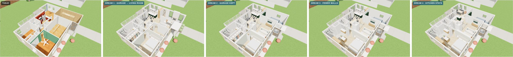
*From left: today, then Dreams 1, 2, 3 and 4, cutaway from the front.*

## How to view it

- **Quick look:** the three-way images below show today, Dream 3 and Dream 4 from the same spot.
- **Interactive model:** download `index.html` and open it in a web browser. It needs an internet connection to load the 3D library.
  - The switch at the top flips between **Today** and **Dreams 1 to 4**.
  - In a cutaway view, drag to orbit and scroll to zoom. In a room view, drag to look around.

## Dream 3: fewer walls

- **Primary suite:** one open room. It runs from sleeping at the front, through a dressing area with wardrobes and a dresser island, to an open bath at the back with the tub and a double vanity. Only the toilet has its own walls, and the shower is behind glass.
- **Hall and laundry:** the hall becomes part of the living room, with the suite and hall bath doors opening off it. The laundry becomes a cupboard with sliding doors.
- **Entry:** the entry addition opens straight into the living room, with a beam where the old front wall was and a coat cabinet.
- **The same as Dream 2:**
  - the kitchen by the deck;
  - dining in the old kitchen spot;
  - the glass stair with a skylight;
  - the living room's media wall and fireplace;
  - the finished garage with lockers.
- **Walls:** about 46 ft of interior wall comes out, plus 6 ft of the old front wall at the entry. Another 15 ft turns into glass, and about 12 ft of new wall goes in.

## Dream 4: kitchen stays

- **Kitchen:** it stays in its current spot as a U.
  - The sink sits under a new window about 6 ft wide in the west wall.
  - A fridge and tall pantry go where the short hall used to open into the kitchen.
  - A cooktop counter along the stair replaces the half wall, so whoever is cooking faces the living room.
  - A green breakfast bar faces the family room.
- **Family room and dining:** they take the bump-out by the deck, with a sofa against the garage wall and the table under the north windows.
- **The same as Dream 3:** the open suite, the open hall and entry, the laundry cupboard and the finished garage.

## Today, Dream 3 and Dream 4

| View | Today · Dream 3 · Dream 4 |
|---|---|
| **Cutaway from the front** | 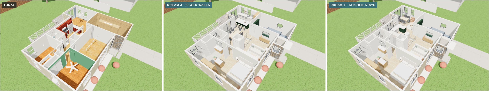 |
| **Cutaway from the back** | 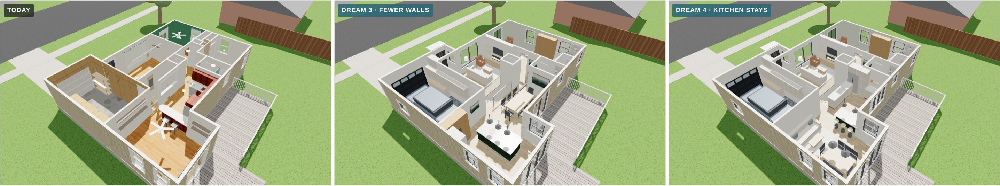 |
| **Just inside the front door** | 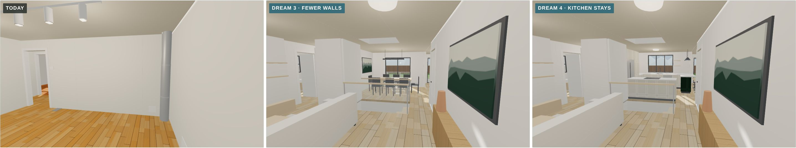 |
| **Front room** | 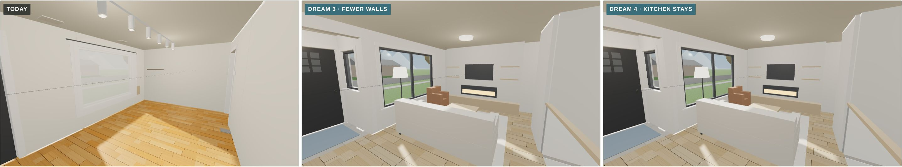 |
| **Primary suite, end to end** | 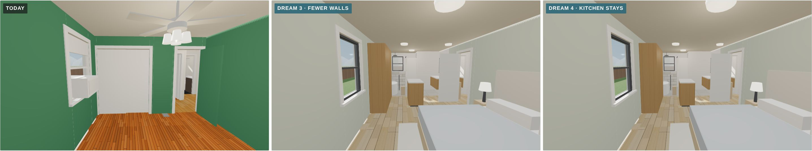 |
| **Garage, looking out** | 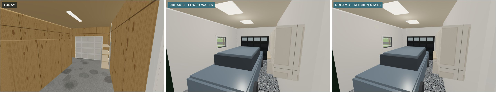 |
| **Garage, looking in** | 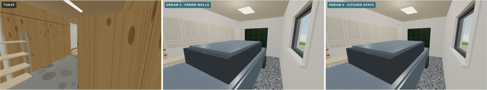 |
| **Toward the deck** | 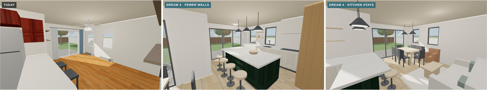 |
| **Back toward the middle** | 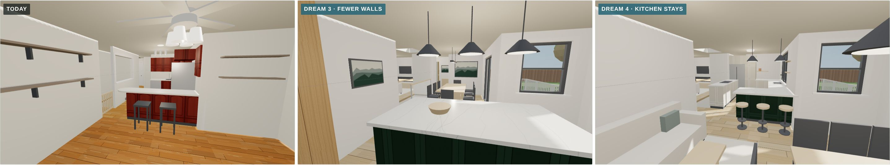 |
| **The old kitchen's west wall** | 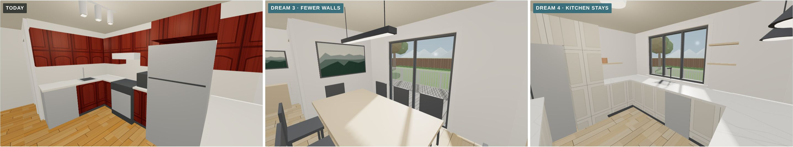 |
| **Primary bedroom** | 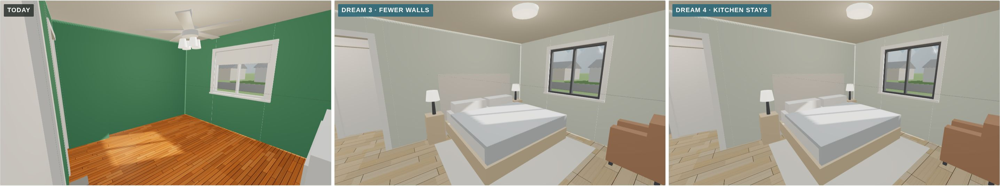 |
| **Spa bath** | 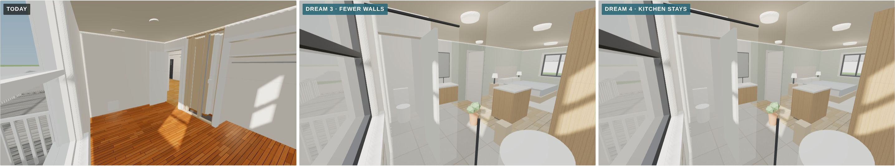 |

Each Dream 3 and Dream 4 view is also saved on its own, for example `dream-4-old-kitchen-west-wall.jpg`.

## Approximations

- **Finishes are placeholders**, the same as the other dream plans.
- **Not yet checked:**
  - the beams for the wider openings;
  - the header for the new kitchen window;
  - the entry addition's setback.
- **Unchanged:** the roof is left off, and the deck is the existing one.
- **The other models in this file** (Today and Dreams 1 and 2) match their own folders.
