# Dream plans 6 and 7 in 3D (November 8, 2026)

These are 3D models of two more budget-no-object layouts. Both turn the garage into the living room, as Dream 5 does, but keep the kitchen where it is.

- **Dream 6, kitchen stays** ([concept 11](../../concepts/2026-11-08-layout-concepts/#11--kitchen-stays-garage-converted)): Dream 5 with the kitchen in its current spot, opened up around a big new window over the sink. The bump-out by the deck becomes the dining room.
- **Dream 7, two bedrooms** ([concept 12](../../concepts/2026-11-08-layout-concepts/#12--kitchen-stays-two-bedrooms)): Dream 6 with two bedrooms on the main floor instead of the open suite, and a small bath for the primary bedroom between them.

They're built in the same scene as the [baseline](../2026-11-08-baseline/) and Dreams [1](../2026-11-08-dream-plan/), [2](../2026-11-08-dream-plan-garage-kept/), [3 and 4](../2026-11-08-dream-plans-3-and-4/) and [5](../2026-11-08-dream-plan-5-no-garage/), so all eight can be compared from the same camera.

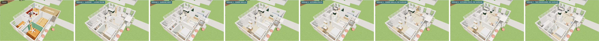
*From left: today, then Dreams 1 to 7, cutaway from the front.*

## How to view it

- **Quick look:** the three-way images below show today, Dream 6 and Dream 7 from the same spot.
- **Interactive model:** download `index.html` and open it in a web browser. It needs an internet connection to load the 3D library.
  - The switch at the top flips between **Today** and **Dreams 1 to 7**.
  - In a cutaway view, drag to orbit and scroll to zoom. In a room view, drag to look around.

## Dream 6: kitchen stays, no garage

- **Kitchen:** it stays in its current spot as a U, as in Dream 4.
  - The sink sits under a new window about 6 ft wide.
  - A fridge and a pull-out pantry go on the south wall, beside the short hall, which stays open.
  - A cooktop counter along the stair replaces the half wall.
  - A green breakfast bar faces the dining room.
- **Dining room:** the bump-out gets a table for ten, with a low drinks bar and buffet where the garage wall was.
- **The same as Dream 5:**
  - the sunken living room in the old garage, with wide steps on two sides;
  - the library and entry in the front room;
  - the open suite, open hall and laundry cupboard.
- **Walls:** about 80 ft of interior wall comes out, 7 ft turns into glass, and about 12 ft of new wall goes in.

## Dream 7: kitchen stays, two bedrooms

- **Bedrooms:** both stay where they are and keep the walls they have now. Wardrobes replace the closets.
- **Primary bath:** the closets, linen closet and flue chase between the bedrooms become a bath about 4 × 8 ft, with a shower, a vanity and a toilet. A pocket door opens to it from the primary bedroom.
- **Bedroom 2:** room for a queen bed and a desk. It shares the hall bath with guests.
- **The same as Dream 6:** the kitchen, the dining room, the living room and the library.
- **Walls:** about 54 ft of interior wall comes out, 7 ft turns into glass, and no new walls go in.

## Today, Dream 6 and Dream 7

| View | Today · Dream 6 · Dream 7 |
|---|---|
| **Cutaway from the front** | 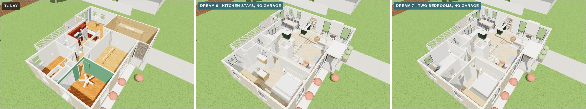 |
| **Cutaway from the back** | 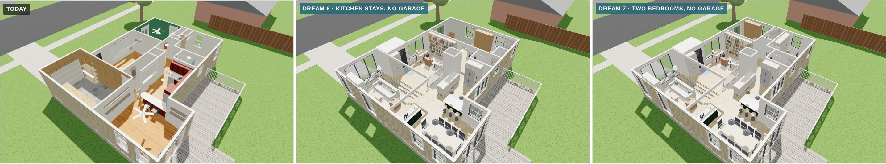 |
| **Just inside the front door** | 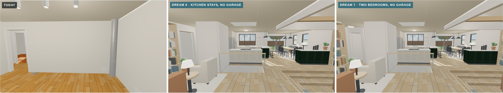 |
| **North from the front room** | 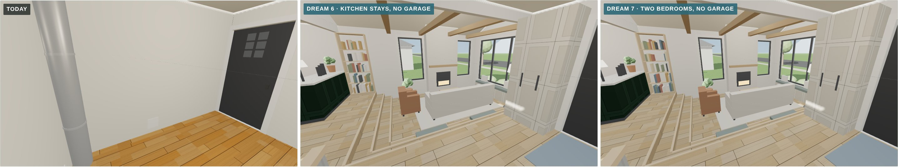 |
| **Primary suite, end to end** | 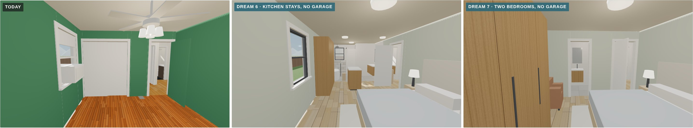 |
| **Garage end, looking in** | 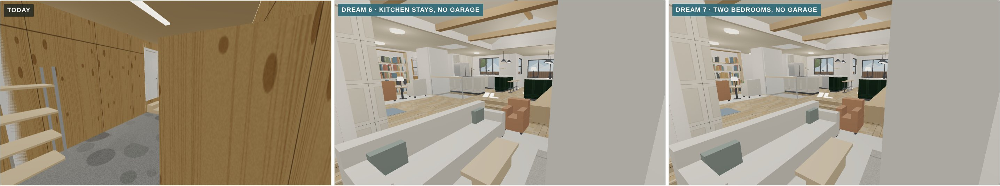 |
| **Toward the deck** | 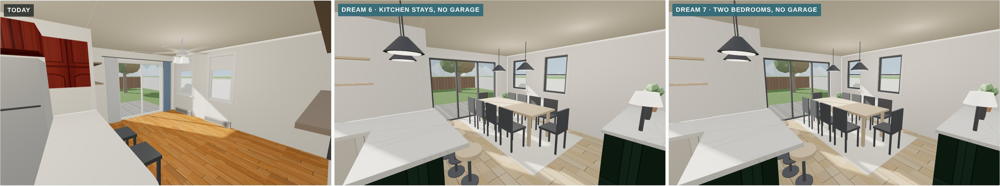 |
| **Back toward the middle** | 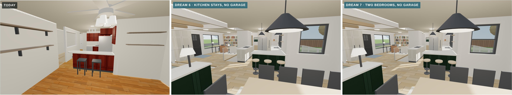 |
| **The old kitchen's west wall** | 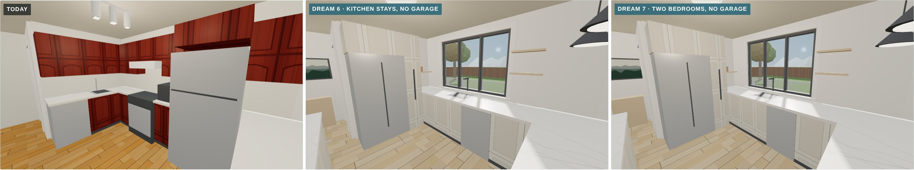 |
| **Primary bedroom** | 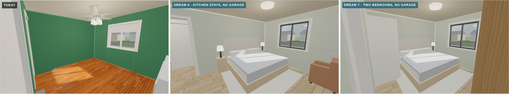 |
| **Spa bath, or bedroom 2 in Dream 7** | 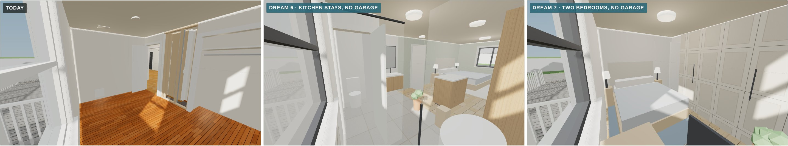 |

Each Dream 6 and Dream 7 view is also saved on its own, for example `dream-7-suite-end-to-end.jpg`.

## Approximations

- **Finishes are placeholders**, the same as the other dream plans.
- **Not yet checked:**
  - whether the city allows the garage to become living space without parking elsewhere;
  - the beams for the garage walls, the landing and the vaulted ceiling;
  - the header for the new kitchen window;
  - for Dream 7, the furnace and water heater switching to direct-vent units, so the flue chase can come out.
- **Unchanged:** the roof is left off, and the deck is the existing one.
- **The other models in this file** match their own folders.
