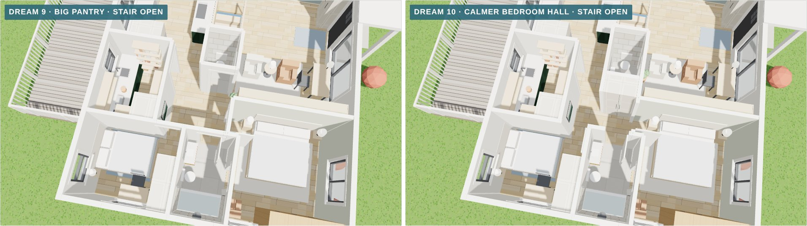
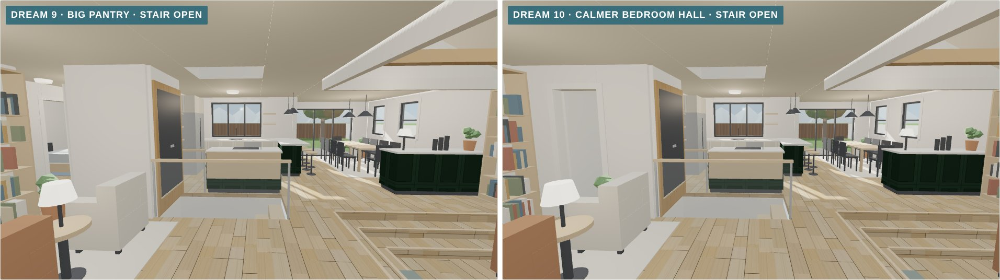
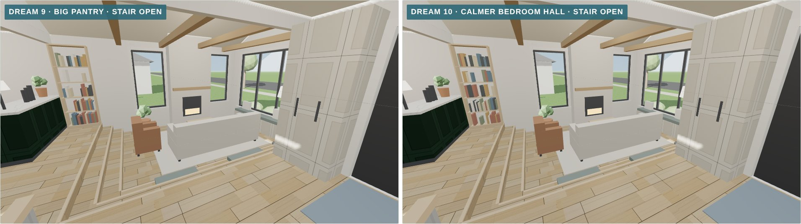
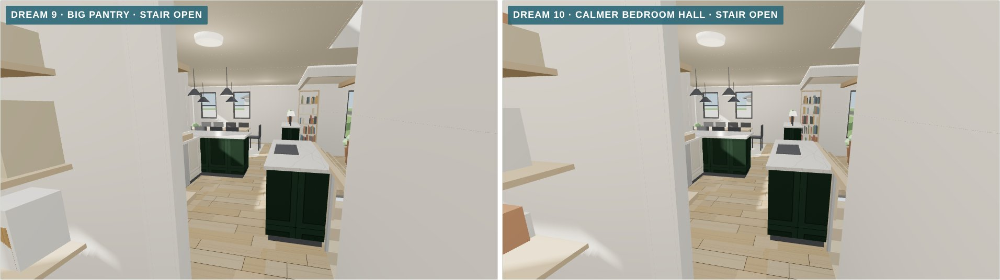
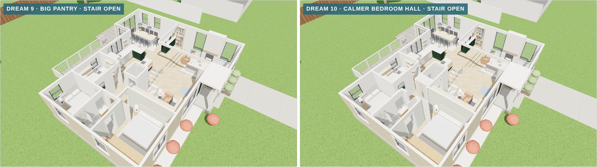
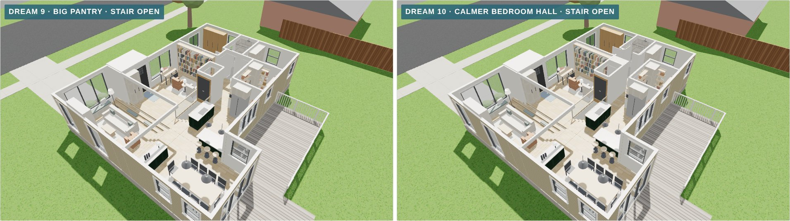

# Dream 10, a calmer bedroom hall, in 3D (November 9, 2026)

This is a 3D model of [concept 16](../../concepts/2026-11-08-layout-concepts/#16--dream-10-a-calmer-bedroom-hall): [Dream 9](../2026-11-09-dream-9-big-pantry/), with the tangle where the bedrooms, the pantry, the powder room and the library doorway meet cleaned up. In Dream 9, seven openings share about 50 sq ft of hall.

- **Doorway from the library closed:** the bedroom hall has one way in, from the kitchen, and nobody passes through it on the way to somewhere else.
- **Linen cabinet:** a full-height built-in, 3½ ft wide and 2 ft deep, takes the doorway's place, facing the bedroom hall.
- **Powder room:** back at full size, about 3½ × 5 ft, with its door off the library, so guests use it from the entry and never walk into the bedroom hall.
- **Flush doors:** the doors to the bath and both bedrooms are 8-ft flush slabs with no trim, painted the wall color, so they read as one quiet wall. A picture hangs at the end of the hall on the pantry wall.
- **The same as Dream 9:** the big pantry, the shared bath, both bedrooms, the kitchen, the library, the garage living room and the stairwell's three settings.

It's built in the same scene as today and the other dream plans, so they can all be compared from the same camera. A new view, **The bedroom hall from above**, shows the change most clearly.

*Dream 9 (left) and Dream 10, the bedroom hall from above.*

## How to view it

- **Quick look:** the images below compare Dream 9 with Dream 10 from the same spot.
- **Interactive model:** download `index.html` and open it in a web browser. It needs an internet connection to load the 3D library. Pick **Dream 10** in the switch at the top, then try the stairwell switch.

## Dream 9 and Dream 10

| View | Dream 9 · Dream 10 |
|---|---|
| **The bedroom hall from above** |  |
| **Front door** |  |
| **North from the front room** |  |
| **Out of the bedroom hall** |  |
| **Cutaway from the front** |  |
| **Cutaway from the back** |  |

Each Dream 10 view is also saved on its own, for example `dream-10-bedroom-hall-from-above.jpg`. The stairwell's other two settings are saved as `dream-10-table-…` and `dream-10-floor-…`.

## Approximations

- **Finishes are placeholders**, the same as the other dream plans.
- **Not yet checked:** the same items as Dream 9, plus the full-height doors, which need 8-ft slabs and concealed hinges.
- **Unchanged:** the roof is left off, and the deck is the existing one.
- **Dream 9 in this file** has two small fixes since its own folder: a console that floated where a wall used to be is gone, and the same picture now hangs at the end of its bedroom hall.
