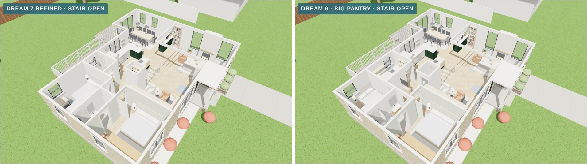
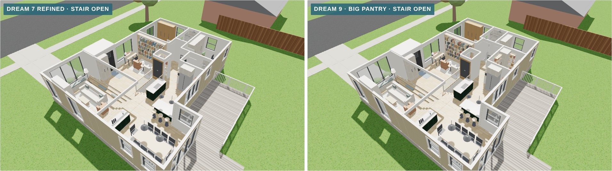
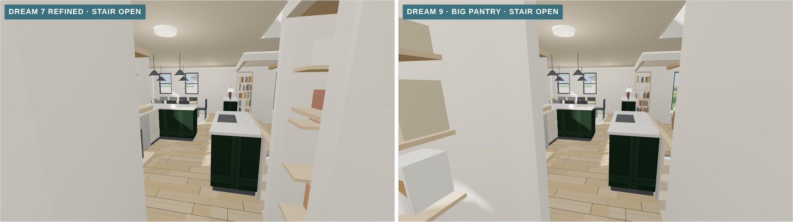
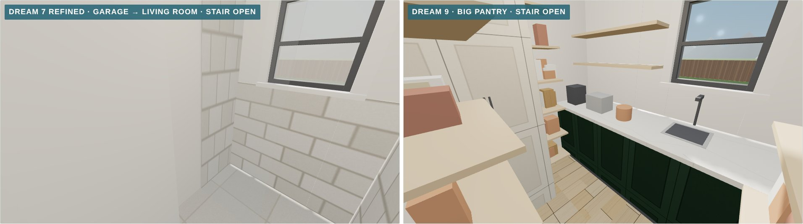
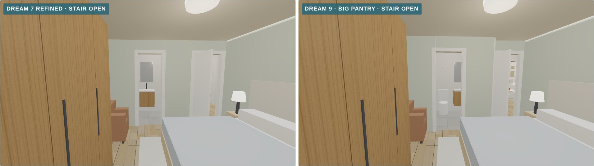
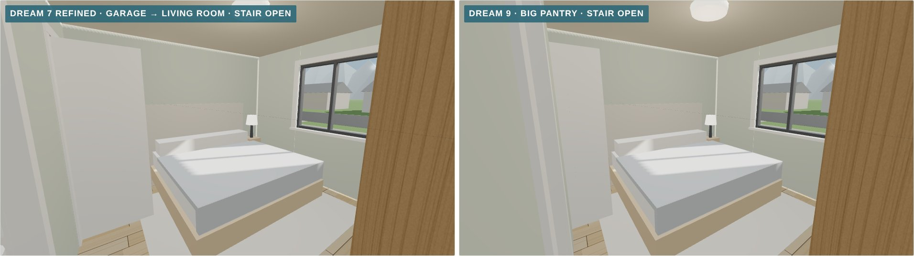
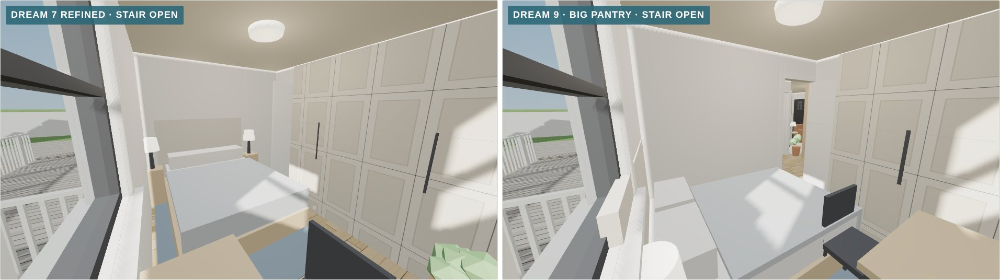

# Dream 9, the big pantry, in 3D (November 9, 2026)

This is a 3D model of [concept 15](../../concepts/2026-11-08-layout-concepts/#15--dream-9-the-big-pantry): [Dream 7 refined](../2026-11-08-dream-7-refined/), with the bedroom end reworked around a big working pantry.

- **Pantry:** the hall bath and the north 3½ ft of bedroom 2 become a pantry of about 56 sq ft, five times the old one. It has a counter with a prep sink under the window, shelves on three walls, and the washer and dryer in a closet in the corner. It opens off the hall, a step from the kitchen.
- **Shared bath:** the bath between the bedrooms grows a foot into the primary bedroom, to 5 × 8 ft with a tub. It has a door from the new short hall and a pocket door from the primary bedroom.
- **Powder room:** the old pantry and a foot of the hall become a powder room for guests. That leaves a 3 ft way through from the library to the bedrooms.
- **Bedrooms:** bedroom 2 is about 9½ × 8 ft, with a full bed, wardrobes and a desk. The primary bedroom is a foot narrower, about 10½ × 11½ ft, and keeps its king bed.
- **The same as Dream 7 refined:** the kitchen, the island, the stairwell's three settings, the library and entry, and the garage as a sunken living room.

It's built in the same scene as today and the other dream plans, so they can all be compared from the same camera.

*Dream 7 refined (left) and Dream 9, cutaway from the front.*

## How to view it

- **Quick look:** the images below compare Dream 7 refined with Dream 9 from the same spot.
- **Interactive model:** download `index.html` and open it in a web browser. It needs an internet connection to load the 3D library. Pick **Dream 9** in the switch at the top, then try the stairwell switch.

## Dream 7 refined and Dream 9

| View | Dream 7 refined · Dream 9 |
|---|---|
| **Cutaway from the front** |  |
| **Cutaway from the back** |  |
| **Out of the bedroom hall** |  |
| **Hall bath, now the pantry** |  |
| **The bedrooms, end to end** |  |
| **Primary bedroom** |  |
| **Bedroom 2** |  |

Each Dream 9 view is also saved on its own, for example `dream-9-pantry.jpg`. The stairwell's other two settings are saved as `dream-9-table-…` and `dream-9-floor-…`.

## Approximations

- **Finishes are placeholders**, the same as the other dream plans.
- **Not yet checked:**
  - that bedroom 2, at about 76 sq ft, meets your city's minimum room size (the usual minimum is 70 sq ft and 7 ft in any direction);
  - that the prep sink and the washer can reuse the hall bath's drain and supply lines, and that the powder room can tie into the stack beside the old pantry;
  - the same items as Dream 7 refined: the garage conversion, the beams, the window header, the venting for the furnace and water heater, and the stairwell panels.
- **Unchanged:** the roof is left off, and the deck is the existing one.
- **The primary bedroom camera** moved about 10 inches toward the front of the house, so it stays inside the narrower bedroom. The other models in this file match their own folders apart from that view.
