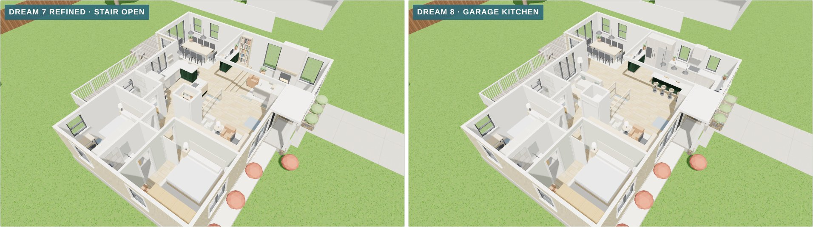
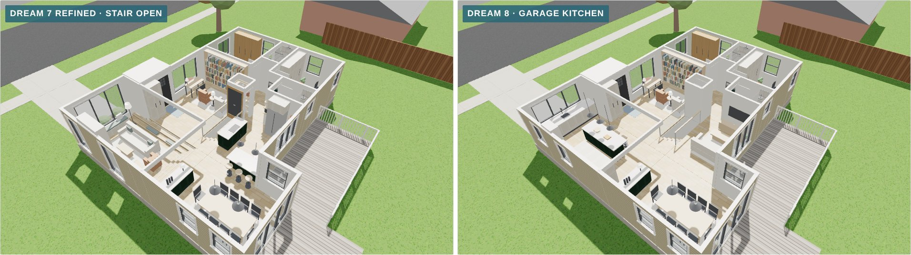
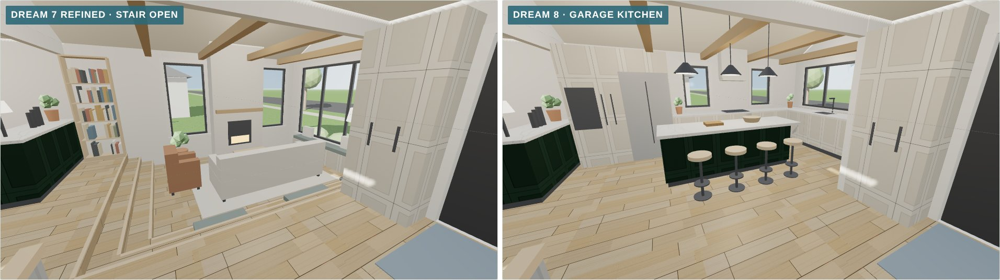
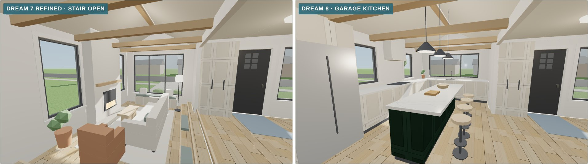
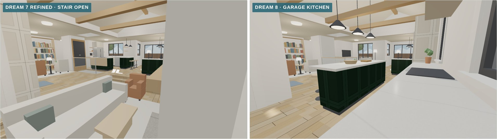
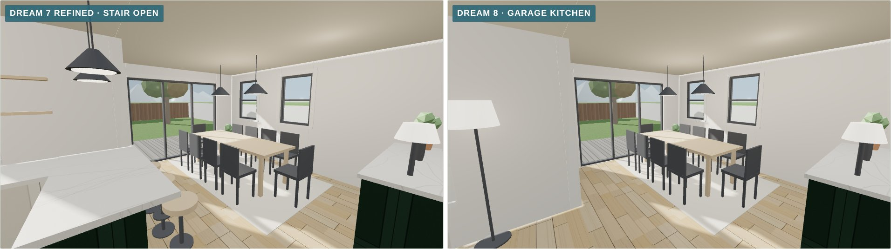
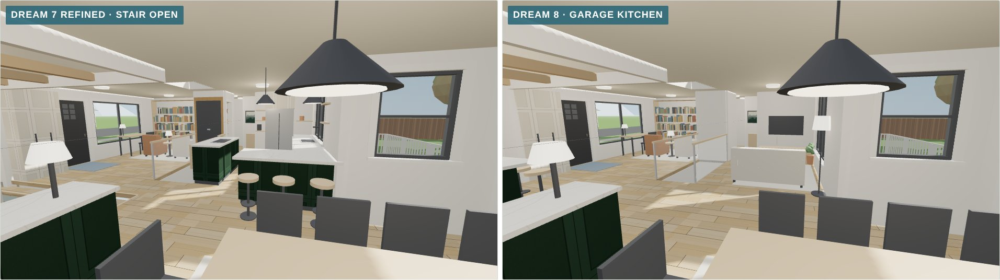
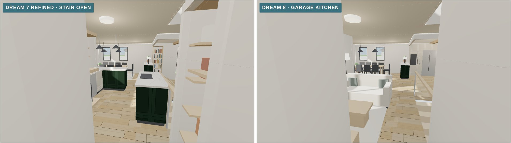
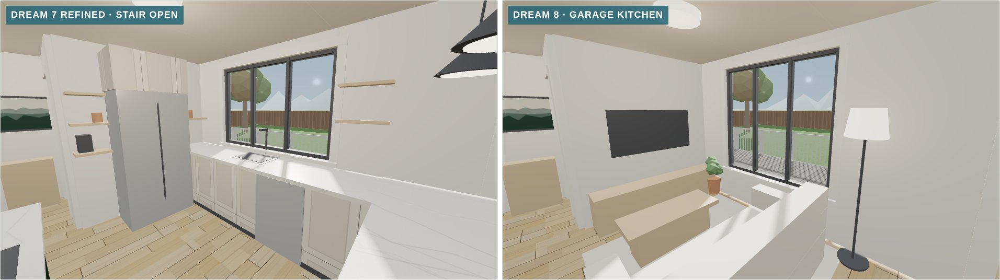

# Dream 8, the garage kitchen, in 3D (November 9, 2026)

This is a 3D model of [concept 14](../../concepts/2026-11-08-layout-concepts/#14--garage-kitchen): [Dream 7 refined](../2026-11-08-dream-7-refined/), but the garage becomes the kitchen.

- **Kitchen:**
  - The garage floor comes up about 1½ ft to the level of the house on a new framed floor, and the ceiling is vaulted to the rafters.
  - An 8-ft island with four stools sits in the middle.
  - The sink is under a wide window where the garage door was.
  - The range sits between two windows on the north wall, beside a tall wall for the fridge, pantry and ovens.
- **Dining room:** the bump-out, right beside the kitchen, with a low buffet between them and the slider to the deck.
- **Family room:** the old kitchen, with a media wall and a big new window over the deck.
- **The same as Dream 7:** the library and entry in the front room (now open to the kitchen), the two bedrooms, the small primary bath and the laundry cupboard.

It's built in the same scene as today and the other dream plans, so they can all be compared from the same camera.

*Dream 7 refined (left) and Dream 8, cutaway from the front.*

## How to view it

- **Quick look:** the images below compare Dream 7 refined with Dream 8 from the same spot.
- **Interactive model:** download `index.html` and open it in a web browser. It needs an internet connection to load the 3D library. Pick **Dream 8** in the switch at the top.

## Dream 7 refined and Dream 8

| View | Dream 7 refined · Dream 8 |
|---|---|
| **Cutaway from the front** |  |
| **Cutaway from the back** |  |
| **North from the front room** |  |
| **Garage end, looking out** |  |
| **Garage end, looking in** |  |
| **Toward the deck** |  |
| **Back toward the middle** |  |
| **Out of the bedroom hall** |  |
| **The old kitchen's west wall** |  |

Each Dream 8 view is also saved on its own, for example `dream-8-north-from-the-front-room.jpg`.

## Approximations

- **Finishes are placeholders**, the same as the other dream plans.
- **Not yet checked:**
  - whether the city allows the garage to become living space without parking elsewhere;
  - the beams for the garage walls and the vaulted ceiling;
  - the new raised floor, and whether the kitchen drains can reach the basement with enough slope.
- **Unchanged:** the roof is left off, and the deck is the existing one.
- **The other models in this file** match their own folders.
